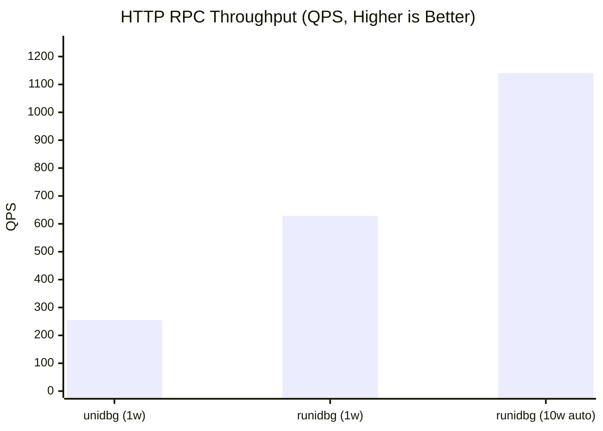
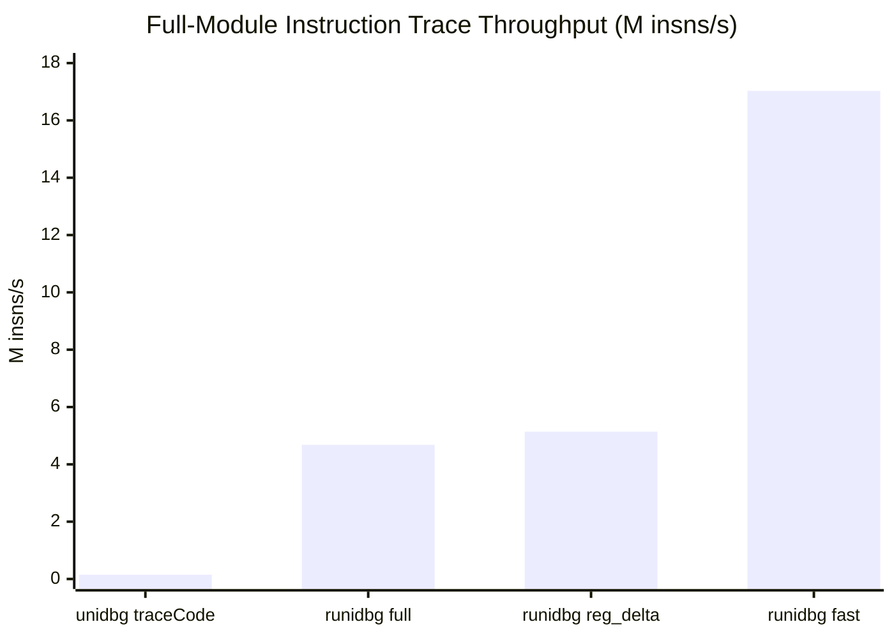
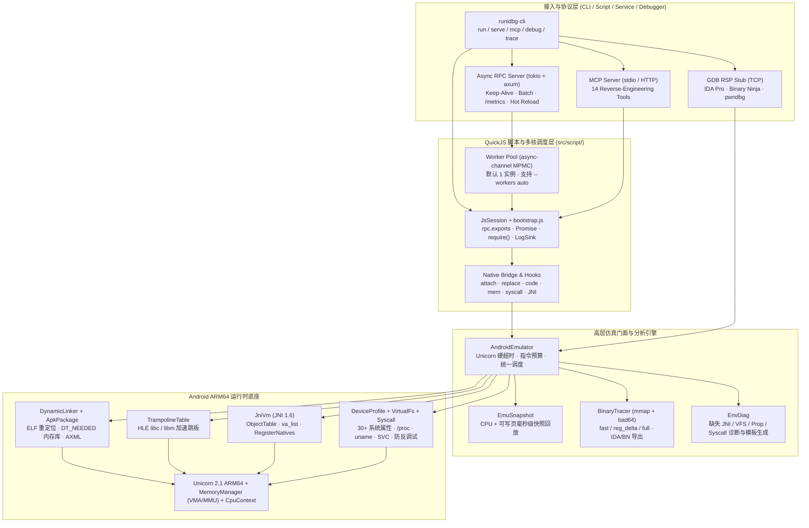

> [!WARNING]
> **免责声明**：本项目（`runidbg`）仅用于**二进制安全研究、逆向工程学习、性能评测及经授权的安全测试**。严禁将本项目用于任何违反法律法规或未经授权的用途；因使用本项目产生的任何后果与法律责任均由使用者自行承担。

<div align="center">

# ⚡ runidbg (`runidbg-arm64-emu-tracer`)

**`Rust + unidbg = runidbg` · 纯 Rust 实现的高性能 Android ARM64 `.so` 仿真器、零拷贝二进制 Tracer 与 QuickJS 脚本引擎**  
内置异步多核 RPC 服务 · MCP AI 逆向闭环 · GDB RSP 远程调试 · 统一设备画像模拟

**简体中文** | [English](./README_EN.md) | [完整使用指南](./docs/GUIDE.md) | [AI Agent Skill](./docs/SKILL.md)


| 🚀 冷启动速度 | 🔥 全模块 Trace 吞吐 | 💾 单实例 RPC 内存 | ⚙️ 多核 RPC 吞吐 | 📦 单条 Trace 体积 |
| :---: | :---: | :---: | :---: | :---: |
| **77 ms** (`22.6×` vs unidbg) | **17.03 M insns/s** (`114×` vs unidbg) | **21.7 MB** (省 `82%`) | **1,141 QPS** (10 核) | **32 B / insn** (省 `3.7×`) |

</div>

---

## 🤝 欢迎提交不兼容样本与反馈

`runidbg` 仍在快速演进中，**非常欢迎通过 Issue / PR 提交在仿真中遇到报错、缺失符号/系统调用/JNI 或结果不一致的 Android ARM64 `.so` 样本与最小复现脚本**，帮助我们持续完善兼容性与生态覆盖！

反馈时请先脱敏去除真实 Cookie / Token 等敏感凭据，推荐附带：
1. **最小复现脚本**（QuickJS 脚本或 Rust 用例）与脱敏测试输入；
2. **`EnvDiag` 诊断输出**（`JSON.stringify(emu.diag.report(), null, 2)`，自动列出缺失文件、系统属性、Syscall 与 JNI）；
3. **崩溃现场报告**（如发生异常，附 `emu.lastCrash()?.formatted` 输出的寄存器、反汇编、调用栈与面包屑）。

---

## ✨ 核心特性

- **🦀 Android ARM64 原生仿真底座**：基于 Unicorn 2.1 + `goblin`，完整支持 ELF 动态链接（`.init_array`、`IRELATIVE`、符号重定位、`DT_NEEDED` 递归加载、TLS `TPIDR_EL0`）、高频 libc/libm HLE 加速（含真实 AAPCS64 `vsnprintf`/`__snprintf_chk`/`sscanf`/`asprintf`/`atoll`）、VMA/MMU 内存管理与防反调试。
- **📱 统一设备画像与双模式时钟（`DeviceProfile`）**：内置 `pixel5` / `pixel8pro` / `s24ultra` / `xiaomi14` 真机画像与任意字段覆盖，一处配置自动联动 **30+ 系统属性**、`/proc/cpuinfo`、`/proc/meminfo`、`/proc/version`、`/sys/devices/system/cpu/online` 与 `uname`；支持确定性虚拟时钟与宿主机实时时钟（`realClock`）一键切换。
- **🧬 JNI 1.6 完整环境**：支持 `JNI_OnLoad`、`RegisterNatives`、容器安全的引用生命周期管理、内置常用 Java 模型（`String` 构造与方法、`Thread.currentThread()`、基础类型装箱 `valueOf` 等）以及可插拔 JS/Rust JNI Hook。
- **⚡ 零拷贝二进制 Tracer**：支持 `fast` / `reg_delta` / `full` 三级分层追踪、`mmap` 双流落盘（`.idx` + `.ext`，结束时精确截断无尾部零填充）、毫秒级离线检索（`dump` / `search`）以及 IDA Pro / Binary Ninja 覆盖率脚本一键导出。
- **📜 QuickJS 零配置脚本引擎 + TypeScript 智能提示**：写 JS 即可完成逆向分析，内置 `Emu` / `Module` / `jni` / `mem` / `regs` / `hook`（Frida 风格 `attach`、`replace`、`code`、`mem`、`syscall`）/ `vfs` / `trace` / `fs` / `require()`，并通过 `runidbg-cli init-types` 导出完整 `runidbg.d.ts`。
- **🌐 生产级异步多核 RPC 服务**：基于 `tokio` + `axum` + 无锁 MPMC Worker 池（`--workers auto`），内置 Keep-Alive、队列背压 `503`、Unicorn 硬超时与指令预算 `504`、JSON-RPC 2.0 Batch、Prometheus `/metrics`、滚动热重载及 `async` 导出。
- **🤖 MCP AI 逆向闭环 & 调试工具链**：原生支持 stdio 与 Streamable HTTP 双模式 MCP（14 个逆向工具，含 `bad64` 反汇编、函数级 Trace、一次性 Hook 抓取、崩溃现场诊断）、`EnvDiag` 缺环境自动诊断器、APK 一键内存加载与 ARM64 GDB RSP 远程调试服务端。

---

## 📊 性能实测对比（vs Java `unidbg`）

> [!NOTE]
> **测试口径**：Apple Silicon（10 核 ARM64 macOS）、JDK 21（`unidbg 0.9.9`）vs `runidbg-cli --release`。样本为同一份 ~2 MB stripped Android ARM64 安全签名 `.so`（含 `libc++_shared.so` 依赖）。以下三组均在**两边 100% 产出相同有效签名结果**的同一调用路径上同口径对齐实测。

### 1. 冷启动与进程内热态调用

| 指标 | Java `unidbg` | Rust `runidbg-cli` | 提升倍率 |
| --- | ---: | ---: | :---: |
| 环境初始化 + `.so` 加载 | 1,666 ms | **40 ms** | **41.7×** |
| `JNI_OnLoad` | 72 ms | **37 ms** | **1.9×** |
| **总冷启动耗时** | 1,738 ms | **77 ms** | **22.6×** |
| 进程内单核热态调用（50 次均值） | 3.80 ms（263.4 QPS） | **1.30 ms（769.2 QPS）** | **2.92×** |

### 2. HTTP RPC 并发服务对比（100% 返回值校验通过）

> Java 侧使用 JDK 21 内置 `HttpServer` 封装单实例 `unidbg`（`synchronized`），Rust 侧直接使用 `runidbg-cli serve`。

| 服务配置 | 校验通过 | 吞吐 (QPS) | p50 延迟 | p95 延迟 | 常驻内存 (RSS) | 对比 |
| --- | :---: | ---: | ---: | ---: | ---: | --- |
| Java `unidbg`（1 worker） | 100/100 | 254.7 | 38.35 ms | 41.03 ms | 122.1 MB | 基线 `1×` |
| Rust `runidbg`（`--workers 1`） | 100/100 | **628.7** | **15.83 ms** | **15.99 ms** | **21.7 MB** | **2.47× QPS · 省 82% 内存** |
| Rust `runidbg`（`--workers auto=10`） | 200/200 | **1,141.0** | **8.74 ms** | 35.94 ms | **127.5 MB** | **4.48× QPS · 10 实例 ≈ Java 1 实例内存** |



### 3. 全模块指令级 Trace 对比（`[base, base+size]`）

| 引擎 / 模式 | 耗时 | 记录条数 | 归一化吞吐 | 单条体积 | 吞吐倍率 |
| --- | ---: | ---: | ---: | ---: | :---: |
| Java `unidbg`（`traceCode` 文本流） | 1,851.1 ms | 275,381 | 0.149 M insns/s | ~118 B/条（31 MB） | `1×` |
| Rust `runidbg`（`fast` 二进制 mmap） | **64 ms** | 1,090,194 | **17.03 M insns/s** | 32 B/条（33 MB） | **114×** |
| Rust `runidbg`（`reg_delta` 二进制 mmap） | **212 ms** | 1,090,194 | **5.14 M insns/s** | 32 B/条（33 MB） | **34.5×** |
| Rust `runidbg`（`full` 双流 + 20.1 万内存 R/W） | **233 ms** | 1,090,194 + 201,209 ext | **4.68 M insns/s** | 32 B/条（33 MB + 6.1 MB） | **31.4×** |



---

## ⚖️ 与 Java `unidbg` 全面对比

| 维度 | `runidbg`（本项目） | Java `unidbg` |
| --- | --- | --- |
| **运行性能与内存** | ✅ 原生 Rust，冷启动快 **22.6×**、单核热态快 **2.9×**、RPC 内存仅 **1/5.6**（21.7 MB vs 122.1 MB） | ⚠️ JVM + JNI/JNA 跨边界开销，冷启动 ~1.7s，单实例 ~122 MB |
| **指令级 Trace** | ✅ 零拷贝 mmap 二进制双流 + 离线 `bad64` 解码，吞吐高 **31×–114×**，自带 `dump`/`search`/IDA/BN 导出 | ⚠️ 热路径实时 Capstone 文本反汇编落盘，吞吐 ~0.15 M/s，文本体积大 3.7× |
| **脚本开发体验** | ✅ **零编译 QuickJS** + 完整 `runidbg.d.ts` 智能提示 + Frida 风格 Hook + `EnvDiag` 自动生成补环境 JS | ⚠️ 需配置 Maven/JDK 工程并编写/编译 Java 代码，迭代周期更长 |
| **工程化与 AI 集成** | ✅ 原生内置多核异步 HTTP/JSON-RPC 2.0、Prometheus `/metrics`、热重载、**MCP 14 工具**、GDB RSP、APK 加载 | ⚠️ 核心定位为 Java 库，RPC 服务池、监控、AI Agent 接入需自行二次封装 |
| **平台与架构支持** | ⚠️ **目前仅支持 Android ARM64（`aarch64`）**，暂不支持 ARM32 与 iOS | ✅ **支持 Android ARM32 / ARM64 以及 iOS（Mach-O / ObjC）** |
| **成熟度与样本生态** | ⚠️ **项目较新**，已验证 Cronet / Conscrypt / MMKV / SQLite / WebP / Zstd / 真实 MSSDK 等，但冷门系统库与长尾样本覆盖仍在持续扩充 | ✅ **多年社区沉淀**，公开案例、教程、Android 系统类桩与边缘 syscall 覆盖非常成熟 |
| **Java 字节码执行** | ⚠️ 无内置 ART/Dalvik 解释器，Java 侧回调依赖内置模型与 JS Hook 补全 | ⚠️ 同样不直接解释执行 DEX 字节码，依赖 `AbstractJni` 补环境 |

> [!TIP]
> **怎么选？**
> - **优先选 `runidbg`**：目标是 **Android ARM64 `.so`**，追求极致启动/并发/Trace 性能，希望用 JS/TS 快速迭代、一键起高并发 RPC 服务，或需要接入 AI Agent（MCP）自动化逆向。
> - **优先选 `unidbg`**：需要仿真 **ARM32** 或 **iOS Mach-O**，或目标依赖大量社区现成 Java 补环境代码与历史方案。

---

## 🏗️ 项目架构



<details>
<summary>📂 展开查看完整源码目录结构</summary>

```text
src/
├── lib.rs              # 库入口与核心导出
├── main.rs             # 最小命令行示例入口（直接加载 .so 并执行指定符号）
├── emulator.rs         # AndroidEmulator / AndroidEmulatorBuilder 门面
├── cpu.rs              # ARM64 寄存器与调用约定封装
├── crash.rs            # Guest 崩溃报告捕获（反汇编、寄存器、调用栈与面包屑）
├── logging.rs          # 结构化日志初始化（compact / json）
├── diag.rs             # 缺环境自动诊断器与 JS 补环境模板生成
├── debug/gdbstub.rs    # ARM64 GDB Remote Serial Protocol 远程调试服务端
├── memory.rs           # VMA 虚拟内存管理与访存辅助
├── snapshot.rs         # 内存 + 寄存器快照保存与恢复
├── error.rs            # 统一错误类型
├── loader/             # ELF 解析、动态链接器、APK 一键加载与 HLE Trampoline
├── os/                 # 设备画像（DeviceProfile）、SVC 系统调用、VFS 虚拟文件系统、协作调度
├── jni/                # JNI 1.6 Env、对象表、va_list 解析与 Hook 处理
├── tracer/             # 高速二进制追踪引擎、记录格式与离线 Reader
├── script/             # QuickJS 脚本引擎、RPC 与 MCP
│   ├── mod.rs          # JsSession / JsRunner / RUNIDBG_DTS 门面
│   ├── bridge.rs       # QuickJS ↔ Rust 原生桥接实现
│   ├── hooks.rs        # 原生函数/指令/内存/Syscall Hook 与 TB 缓存刷新
│   ├── jni_bridge.rs   # JS JNI Hook 桥接
│   ├── bootstrap.js    # JS 运行时封装与 rpc.exports / Promise 调度
│   ├── runidbg.d.ts    # TypeScript 类型声明
│   ├── rpc.rs          # 异步 HTTP + JSON-RPC 2.0 + 多 Worker 池 + Metrics + 热重载
│   └── mcp.rs          # MCP stdio / Streamable HTTP 服务端（14 个逆向工具）
└── bin/runidbg-cli.rs  # 统一命令行工具（run / serve / mcp / debug / trace 分析）
```

</details>

---

## 🧩 Feature 开关

| Feature | 默认启用 | 说明 |
| --- | :---: | --- |
| `js` | ✅ | QuickJS 脚本引擎（`rquickjs`） |
| `rpc` | ✅ | 异步高并发 HTTP / JSON-RPC 2.0 服务（`tokio`、`axum`、`async-channel`、`serde_json`） |
| `mcp` | ✅ | MCP stdio / HTTP JSON-RPC 2.0 服务端（`serde_json`） |
| `apk` | ✅ | APK 一键解析与内存加载（`zip`） |

纯核心库最小构建（不引入 JS / HTTP / ZIP 依赖，仍包含核心仿真、DeviceProfile、Tracer、EnvDiag 与 GDB Stub）：

```bash
cargo build --no-default-features
```

---

## 🚀 快速上手

### 1. 用 QuickJS 编写仿真 + RPC 脚本（20 行即可跑通）

```javascript
/// <reference path="./runidbg.d.ts" />

const emu = Emu.create({
  packageName: "com.example.app",
  device: "pixel8pro",     // 内置 pixel5 / pixel8pro / s24ultra / xiaomi14，也支持自定义对象覆盖
  realClock: true,         // 启用宿主机实时时钟（默认确定性虚拟时钟）
  searchPaths: ["./libs"],
});

emu.diag.enable();         // 开启缺环境自动诊断
const mod = emu.load("./libs/libtarget.so");
emu.jniOnLoad(mod);

emu.jni.hook("com/example/Env", {
  getVersion() { return "1.0.0"; },
});

rpc.exports = {
  sign(url) {
    const u = emu.jni.newString(String(url));
    const ret = emu.call(mod.base + 0x12340, emu.jni.envPtr, 0, u);
    return emu.jni.getStringArray(ret);
  },
};
```

```bash
# 导出 TypeScript 类型声明获得 IDE 补全
cargo run --release --bin runidbg-cli -- init-types examples/scripts

# 直接运行示例脚本（内置 Cronet / TikTok MSSDK 脱敏测试样例）
cargo run --release --bin runidbg-cli -- run examples/scripts/cronet.js
cargo run --release --bin runidbg-cli -- run examples/scripts/tiktok_metasec.js
```

### 2. 启动高并发多核 RPC 服务

```bash
# 默认单实例（workers = 1，常驻内存 ~22 MB）
cargo run --release --bin runidbg-cli -- serve examples/scripts/rpc_demo.js \
  --listen 127.0.0.1:8080

# 生产多核模式（自动匹配 CPU 核数 + 硬指令预算 + 原子热重载）
cargo run --release --bin runidbg-cli -- serve examples/scripts/rpc_demo.js \
  --listen 0.0.0.0:8080 \
  --workers auto \
  --max-queue 2048 \
  --timeout-ms 15000 \
  --max-insns 5000000 \
  --allow-reload
```

常用接口：
- `GET /health`：服务状态、Worker 数、队列负载、热重载版本与导出方法
- `GET /metrics` / `GET /metrics?format=prom`：JSON 或 Prometheus 指标与延迟分桶
- `GET /exports`：列出 `rpc.exports` 全部导出方法
- `POST /call/<method>`：直接调用导出方法（Body 为 JSON 参数数组）
- `POST /rpc`：标准 JSON-RPC 2.0（支持单条与 Batch 数组并行调用）
- `POST /admin/reload`：先校验后原子滚动热重载（需 `--allow-reload`）
- `POST /eval`：动态执行 JS（需 `--allow-eval`）

### 3. 离线二进制 Trace 分析与 IDA / Binary Ninja 导出

```bash
# 查看指令反汇编、寄存器增量与关联内存 R/W（自动探测同级 .ext）
runidbg-cli dump trace_full.idx --skip 0 --limit 50

# 毫秒级检索指定寄存器值 / 访存地址 / PC
runidbg-cli search trace_full.idx --val 0x03000001

# 导出 IDA Pro / Binary Ninja 执行覆盖率高亮脚本
runidbg-cli export-ida trace_full.idx --base 0x40000000 --out ida_cov.py
runidbg-cli export-bn  trace_full.idx --base 0x40000000 --out bn_cov.py
```

### 4. 接入 MCP 客户端（stdio 或 Streamable HTTP）

```json
{
  "mcpServers": {
    "runidbg": {
      "command": "/path/to/target/release/runidbg-cli",
      "args": ["mcp", "--cwd", "/path/to/workspace"]
    }
  }
}
```

或启动 Streamable HTTP MCP 供远程 Agent 接入：
```bash
runidbg-cli mcp --http 127.0.0.1:8090 --cwd .
```

### 5. GDB RSP 远程调试（直连 IDA Pro / Binary Ninja / pwndbg）

```bash
runidbg-cli debug samples/libstatic-webp.so WebPGetDecoderVersion --listen 127.0.0.1:1234
# 在 gdb-multiarch / pwndbg 中连接：
# target remote 127.0.0.1:1234
```

---

## 🧪 测试与校验

```bash
# 全量测试（39/39 通过，覆盖 Cronet / Conscrypt / MMKV / SQLite / WebP / Zstd / TikTok MSSDK / JS / RPC / MCP / GDB / APK / DeviceProfile）
cargo test

# 全 feature 组合 Clippy 零警告校验
cargo clippy --all-targets -- -D warnings
cargo clippy --no-default-features --all-targets -- -D warnings
cargo clippy --no-default-features --features js --all-targets -- -D warnings
cargo clippy --no-default-features --features mcp --all-targets -- -D warnings
```

---

## 🙏 致谢

- 特别致谢 [**unidbg**](https://github.com/zhkl0228/unidbg)（`zhkl0228`）：`runidbg`（`Rust + unidbg`）的设计理念、Android 沙箱思路与 JNI 桥接模型深受 `unidbg` 启发，致敬多年深耕移动安全开源生态的前辈工作。
- 同时感谢 [Unicorn Engine](https://github.com/unicorn-engine/unicorn)、[QuickJS](https://bellard.org/quickjs/) / `rquickjs`、`goblin`、`bad64` 等优秀开源项目。
