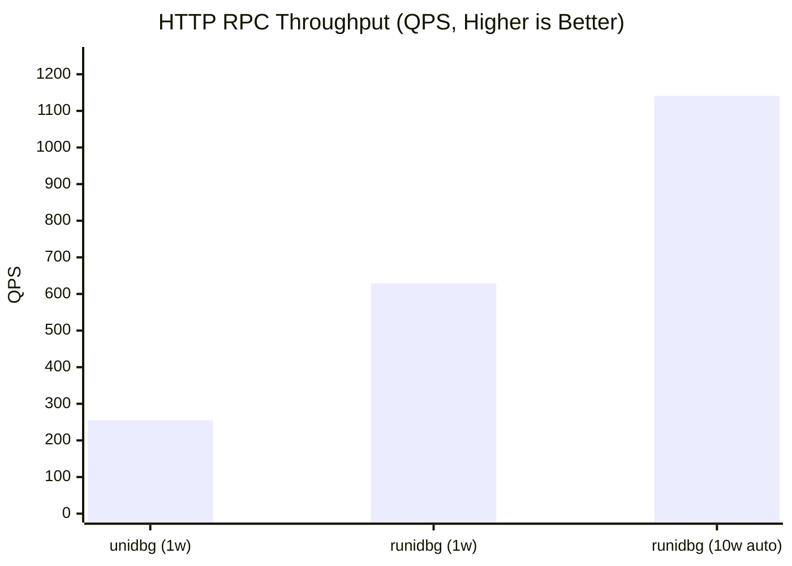
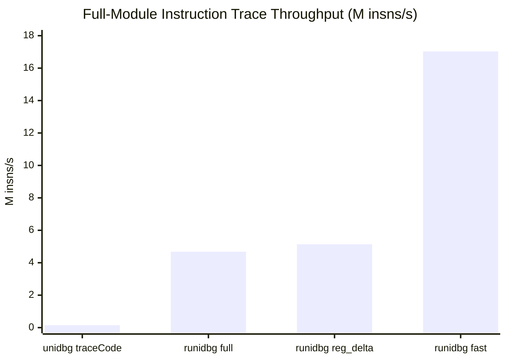
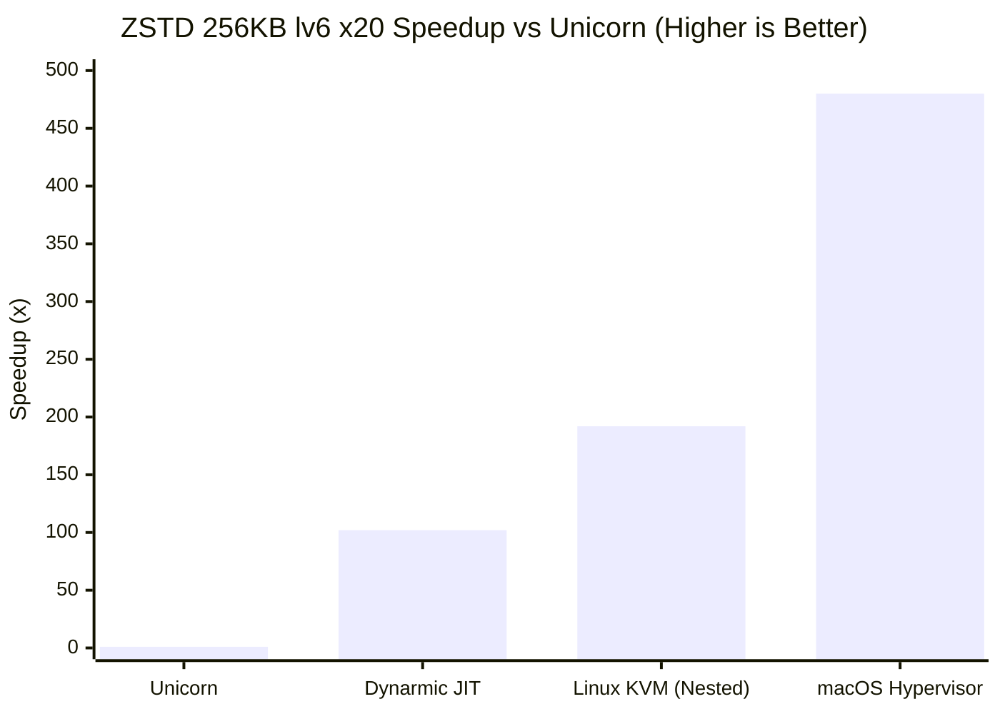
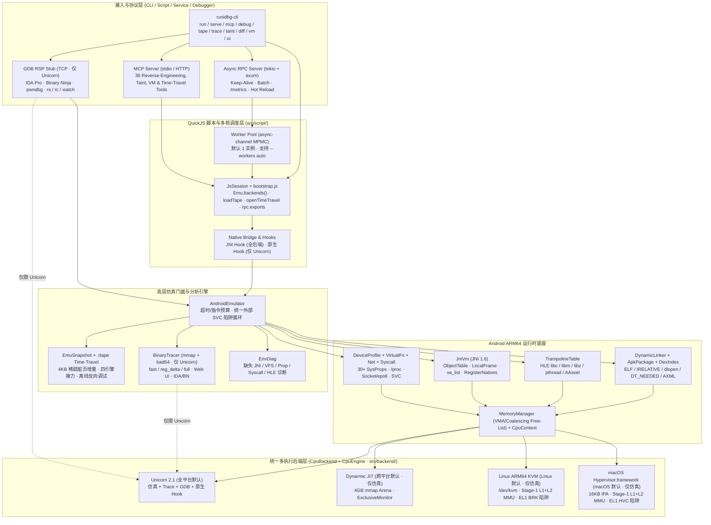

> [!WARNING]
> **免责声明**：本项目（`runidbg`）仅用于**二进制安全研究、逆向工程学习、性能评测及经授权的安全测试**。严禁将本项目用于任何违反法律法规或未经授权的用途；因使用本项目产生的任何后果与法律责任均由使用者自行承担。

<div align="center">

# ⚡ runidbg (`runidbg-arm64-emu-tracer`)

**`Rust + unidbg = runidbg` · 纯 Rust 实现的多后端高性能 Android ARM64 `.so` 仿真器、`.rtape` 时间旅行调试器、零拷贝二进制 Tracer 与 QuickJS 脚本引擎**  
Unicorn / Dynarmic JIT / Linux KVM / macOS Hypervisor.framework 四引擎 · `.rtape` 磁带跨后端接力与反向调试 · 异步多核 RPC · MCP AI 逆向闭环 · GDB RSP

**简体中文** | [English](./README_EN.md) | [完整使用指南](./docs/GUIDE.md) | [AI Agent Skill](./docs/SKILL.md)


| 🚀 冷启动速度 | ⚡ 硬件/JIT 纯算加速 | 🔥 全模块 Trace 吞吐 | 💾 单实例 RPC 内存 | ⚙️ 多核 RPC 吞吐 |
| :---: | :---: | :---: | :---: | :---: |
| **77 ms** (`22.6×` vs unidbg) | **最高 480×** (Hyper/KVM) / **102×** (Dynarmic) | **17.03 M insns/s** (`114×` vs unidbg) | **21.7 MB** (省 `82%`) | **1,141 QPS** (10 核) |

</div>

---

## 🤝 欢迎提交不兼容样本与反馈

`runidbg` 仍在快速演进中，**非常欢迎通过 Issue / PR 提交在仿真中遇到报错、缺失符号/系统调用/JNI 或结果不一致的 Android ARM64 `.so` 样本与最小复现脚本**，帮助我们持续完善兼容性与生态覆盖！

反馈时请先脱敏去除真实 Cookie / Token 等敏感凭据，推荐附带：
1. **最小复现脚本**（QuickJS 脚本或 Rust 用例）与脱敏测试输入；
2. **`EnvDiag` 诊断输出**（`JSON.stringify(emu.diag.report(), null, 2)`，自动列出缺失文件、系统属性、Syscall 与 JNI）；
3. **崩溃现场报告**（如发生异常，附 `emu.lastCrash()?.formatted` 输出的寄存器、反汇编、调用栈与面包屑）。

---

## ✨ 核心特性

- **⚡ 四引擎可插拔 ARM64 执行后端（`CpuBackend` + `CpuEngine`）**：
  - **`unicorn`（默认，全功能）**：基于 Unicorn 2.1，**唯一支持指令级/内存 Trace、GDB RSP 远程调试及原生指令/内存/Syscall Hook** 的后端；
  - **`dynarmic`（跨平台 JIT 加速，仅限仿真模式）**：基于 `dynarmic 0.1.3` 动态二进制翻译（零系统 Boost 依赖，Unix 4GB 连续 `mmap` Arena 规避 128-bit NEON 跨页越界 + 完整 `ExclusiveMonitor` 原子指令支持），重计算加速 **7×–100×**、真实业务加速 **1.4×–5×**；
  - **`kvm`（Linux ARM64 硬件虚拟化，仅限仿真模式，Linux 默认编译）**：零外部 crate 直调 `/dev/kvm` ioctl，内置 Stage-1 L1+L2 恒等页表、ARM64 `dc cvau + ic ivau` I-Cache 维护与局部 `mem_unmap`；
  - **`hypervisor` / `hyper`（macOS Apple Silicon 硬件虚拟化，仅限仿真模式，macOS 默认编译）**：零外部 crate 直调 `Hypervisor.framework`，16KB 宿主物理页 + 4KB Android 逻辑页视图 + Stage-1 L1+L2 恒等页表，纯算加速高达 **480×** vs Unicorn、**4.7×** vs Dynarmic。
- **🦀 Android ARM64 原生运行时底座**：基于 `goblin` 完整支持 ELF 动态链接（`.init_array`, `R_AARCH64_IRELATIVE`, 符号重定位, `DT_NEEDED` 递归加载, `dlopen` / `dlsym` / `dladdr` / `dl_iterate_phdr`, TLS `TPIDR_EL0`）、高频 `libc` / `libm` / `libz` / `AAssetManager` / `pthread` / `setjmp` / `longjmp` 与目录枚举 HLE 加速、带前后空闲块合并（Coalescing Free-List）的真实堆分配器、完整快照回滚（CPU + 可写内存 + 堆元数据 + JNI 引用表）与防反调试。
- **📱 统一设备画像与双模式时钟（`DeviceProfile`）**：内置 `pixel5` / `pixel8pro` / `s24ultra` / `xiaomi14` 真机画像与任意字段覆盖，一处配置自动联动 **30+ 系统属性**、`/proc/cpuinfo`, `/proc/meminfo`, `/proc/version`, `/sys/devices/system/cpu/online` 与 `uname`；支持确定性虚拟时钟与宿主机实时时钟（`realClock`）一键切换。
- **🧬 JNI 1.6 完整环境**：支持 `JNI_OnLoad`, `RegisterNatives`、容器安全的引用生命周期与 `PushLocalFrame` / `PopLocalFrame`（JS 侧 `emu.jni.withLocalFrame` 自动回收常驻 RPC 临时引用与缓冲）、内置常用 Java 模型（`String` 构造与方法、`Thread.currentThread()`、基础类型装箱 `valueOf` 等）以及可插拔 JS/Rust JNI Hook。
- **🌍 宿主机 Socket 透传、异步事件原语与虚拟网卡（`emu.net`）**：零额外依赖内置真实 TCP/UDP Socket 透传、`epoll` / `ppoll` / `eventfd2` / `pipe2` 异步事件循环、`getaddrinfo` / `getifaddrs` / `ioctl(SIOCGIF*)` 与 `/proc/net/*` 虚拟网卡画像，支持 QuickJS 抓包与 `onSend` / `onRecv` 实时改包；**运行期默认关闭真实联网（`-EACCES` 离线护栏），支持 `allowHosts` 白名单显式放行**。
- **⚡ 零拷贝二进制 Tracer、HLE 统一流、离线污点与 VM 专项分析**：
  - 支持 `fast` / `reg_delta` / `full` 三级分层追踪、`mmap` 双流落盘（`.idx` + `.ext`，默认容量 `262144`，截断自动告警并暴露 `stats.truncated`）；`full` 模式将 HLE `memcpy`/`memmove`/`memset`/`bzero`/`malloc`/`calloc`/`realloc`/`free` 统一写入 `.ext` 时间轴；
  - 内置纯 Rust **字节级前向污点追踪与反向因果切片**（`runidbg-cli taint` / `Trace.open().taintForward/taintBackward`，自动跨越 HLE `memcpy` 与 S-Box 变址查表，免疫栈帧/VM 寄存器堆地址复用）、**离线全知内存/值查询与任意时刻内存重建**（`Trace.open().query/findWrites/findReads/hleEvents/reconstructMem`）、**双跑差分**（`runidbg-cli diff` / `Trace.diff`）以及 **OLLVM / 自定义字节码 VM 专项分析**（`runidbg-cli vm` / `Trace.open().vmAnalyze` / 在线 `emu.vm.watchRegfile` + `decodeWord`，自动识别 Dispatch Loop、4B/8B 跳转表、字节码 PC 寄存器、Handler 步长分布与基址搬家差分）；
  - 毫秒级离线检索（`dump` / `search|find --val --addr --pc --ascii --bytes` / `stats` / `calltree` / `crypto-scan`）与 IDA Pro / Binary Ninja 覆盖率脚本一键导出。
- **📜 QuickJS 零配置脚本引擎 + TypeScript 智能提示**：写 JS 即可完成逆向分析，内置 `Emu` / `Module` / `Trace` / `jni` / `mem` / `regs`（含无损 64-bit `BigInt` `ctx.reg64()` / `emu.regs.get64()`）/ `hook`（Frida 风格 `attach`, `replace`, `code`, `mem` Rust 侧值/宽度/PC 过滤与未映射页告警, `watch`, `syscall`）/ `vm`（在线寄存器堆跟踪与指令字解码）/ `vfs` / `net` / `trace` / `fs` / `require()`，支持 `--freeze-layout` 隔离宿主分配稳定 guest 堆地址与 `emu.heapLayout()` 布局诊断，并通过 `runidbg-cli init-types` 导出完整 `runidbg.d.ts`。
- **🌐 生产级异步多核 RPC 服务**：基于 `tokio` + `axum` + 无锁 MPMC Worker 池（`--workers auto`），内置 Keep-Alive、队列背压 `503`、Unicorn 硬超时与指令预算 `504`、JSON-RPC 2.0 Batch、Prometheus `/metrics`、滚动热重载及 `async` 导出。
- **📼 `.rtape` 持久化运行磁带与时间旅行调试（Phase 1 + Phase 2）**：
  - **多检查点稀疏脏页增量 + 四引擎无缝接力**：将 CPU 寄存器、VMA / 堆 / `[host-scratch]` / 非零 4KB 页、动态链接器与 APK 内存库、HLE 句柄、JNI 引用表与 `DexIndex`、VFS / Socket 状态压缩为单文件 `.rtape`（首个 `BASE` 跳过全零页，后续 `DELTA` 仅存 4KB 脏页 diff），支持 **`Dynarmic` / `Hypervisor` / `KVM` 极速跑完初始化 → 存盘 → 切入 `Unicorn` 做 Trace / GDB / 精录**；
  - **确定性时间旅行与反向污点溯源**：内置 `EventLogBus` 自动捕获实时时钟（`realClock`）、外部 `JniHandler` 回调的 `ObjectTableDelta` 以及只读宿主机 `sysroot` 文件，实现 **脱离原 JS 运行时的 100% bit-exact 离线重放**（实测 416 万条指令录制仅 5.5 MB，全 43 关键帧逐位校验通过）；配合 LRU 关键帧缓存 + 微快照环支持毫秒级 `seek`、亚毫秒级单步回退（`rs` / `bs`）、GDB 反向继续（`rc` / `bc`）、反向内存写/读/访问观察点（`Z2` / `Z3` / `Z4`）、Live Fork 探索与暗黑 Web UI 时间轴面板（`runidbg-cli ui <file.rtape>`）。
- **🤖 MCP AI 逆向闭环 & 调试工具链**：原生支持 stdio 与 Streamable HTTP 双模式 MCP（**36 个逆向工具**，覆盖 `bad64` 反汇编、`trace_calltree`, `trace_crypto_scan`, `trace_inspect`, `trace_taint`, `trace_query`, `trace_diff`, `trace_vm_analyze`, `emu_load_dex`, `emu_save_tape` / `emu_load_tape` / `emu_seek_tape` 以及 `tt_record_start` / `tt_record_stop` / `tt_open` / `tt_seek` / `tt_reverse_watch` / `tt_mem_read` / `tt_close` 时间旅行工具链）、`EnvDiag` 缺环境自动诊断器、轻量 DEX 元数据索引、完整 `stdio` HLE、内置暗黑 Web UI（Trace 分析 + 时间旅行驾驶舱 + RPC 看板 + EnvDiag）、APK 一键内存加载与支持时间旅行的 ARM64 GDB RSP 远程调试服务端。

---

## 📊 性能实测对比（vs Java `unidbg`）

> [!NOTE]
> **测试口径**：Apple Silicon（10 核 ARM64 macOS）、JDK 21（`unidbg 0.9.9`）vs `runidbg-cli --release`。样本为同一份 ~2 MB stripped Android ARM64 安全签名 `.so`（含 `libc++_shared.so` 依赖）。以下三组均在**两边 100% 产出相同有效签名结果**的同一调用路径上同口径对齐实测。

### 1. 冷启动与进程内热态调用

| 指标 | Java `unidbg` | Rust `runidbg-cli` | 提升倍率 |
| --- | ---: | ---: | :---: |
| 环境初始化 + `.so` 加载 | 1,666 ms | **40 ms** | **41.7×** |
| `JNI_OnLoad` | 72 ms | **37 ms** | **1.9×** |
| **总冷启动耗时** | 1,738 ms | **77 ms** | **22.6×** |
| 进程内单核热态调用（50 次均值） | 3.80 ms（263.4 QPS） | **1.30 ms（769.2 QPS）** | **2.92×** |

### 2. HTTP RPC 并发服务对比（100% 返回值校验通过）

> Java 侧使用 JDK 21 内置 `HttpServer` 封装单实例 `unidbg`（`synchronized`），Rust 侧直接使用 `runidbg-cli serve`。

| 服务配置 | 校验通过 | 吞吐 (QPS) | p50 延迟 | p95 延迟 | 常驻内存 (RSS) | 对比 |
| --- | :---: | ---: | ---: | ---: | ---: | --- |
| Java `unidbg`（1 worker） | 100/100 | 254.7 | 38.35 ms | 41.03 ms | 122.1 MB | 基线 `1×` |
| Rust `runidbg`（`--workers 1`） | 100/100 | **628.7** | **15.83 ms** | **15.99 ms** | **21.7 MB** | **2.47× QPS · 省 82% 内存** |
| Rust `runidbg`（`--workers auto=10`） | 200/200 | **1,141.0** | **8.74 ms** | 35.94 ms | **127.5 MB** | **4.48× QPS · 10 实例 ≈ Java 1 实例内存** |



### 3. 全模块指令级 Trace 对比（`[base, base+size]`）

| 引擎 / 模式 | 耗时 | 记录条数 | 归一化吞吐 | 单条体积 | 吞吐倍率 |
| --- | ---: | ---: | ---: | ---: | :---: |
| Java `unidbg`（`traceCode` 文本流） | 1,851.1 ms | 275,381 | 0.149 M insns/s | ~118 B/条（31 MB） | `1×` |
| Rust `runidbg`（`fast` 二进制 mmap） | **64 ms** | 1,090,194 | **17.03 M insns/s** | 32 B/条（33 MB） | **114×** |
| Rust `runidbg`（`reg_delta` 二进制 mmap） | **212 ms** | 1,090,194 | **5.14 M insns/s** | 32 B/条（33 MB） | **34.5×** |
| Rust `runidbg`（`full` 双流 + 20.1 万内存 R/W） | **233 ms** | 1,090,194 + 201,209 ext | **4.68 M insns/s** | 32 B/条（33 MB + 6.1 MB） | **31.4×** |



### 4. 多执行后端实测对比（`Unicorn` vs `Dynarmic` vs `Hypervisor` / `KVM`）

> [!NOTE]
> 以下为同一 `runidbg-cli` 在 **Apple Silicon M4**（dev 构建，对比 Unicorn / Dynarmic / Hypervisor.framework）与 **Ubuntu 26.04 Linux 7.0 `aarch64`**（M4 嵌套虚拟化真 `/dev/kvm`）上 100% 比特级一致输出的实测数据：

| 场景 | Unicorn | Dynarmic (JIT) | Hypervisor (macOS M4) | KVM (Linux ARM64 嵌套) | 最高加速比 |
| --- | ---: | ---: | ---: | ---: | :---: |
| **ZSTD 256KB lv6 × 20 轮**（重纯算/NEON） | 24,964 ms | 245 ms (`102×`) | **52 ms (`480×`)** | 105 ms (`192×`) | **480×** |
| **ZSTD 26.4KB lv3 × 100 轮**（轻纯算/高频调用） | 493 ms | **10 ms (`49×`)** | 14 ms (`35×`) | 113 ms (`8.3×`) | **49×** |
| **TikTok `libmetasec_ov.so` 10× 签名**（重 HLE/JNI） | 398 ms | 76 ms (`5.2×`) | **37 ms (`10.8×`)** | 623 ms（裸机 ~30–40ms） | **10.8×** |



> [!TIP]
> **后端选择建议**：
> - **逆向分析 / 指令 Trace / GDB 调试 / 原生指令与内存 Hook** → 必须选 **`unicorn`**（其余后端仅限仿真模式，调用 Trace / GDB / 原生 Hook 会立即返回明确错误）。
> - **高吞吐算法计算 / 批量离线签名 / RPC 生产服务** → 优先选 **`dynarmic`**（无签名限制、支持单进程多 Worker 并发）或硬件虚拟化 **`hypervisor`**（macOS Apple Silicon，需 `com.apple.security.hypervisor` 签名，单进程限 1 VM）/ **`kvm`**（Linux ARM64 `/dev/kvm`，支持单进程多 VM）。

---

## ⚖️ 与 Java `unidbg` 全面对比

| 维度 | `runidbg`（本项目） | Java `unidbg` |
| --- | --- | --- |
| **运行性能与内存** | ✅ 原生 Rust + **四执行引擎（Unicorn / Dynarmic / KVM / Hypervisor）**，冷启动快 **22.6×**、纯算硬件加速最高 **480×**、RPC 内存仅 **1/5.6**（21.7 MB vs 122.1 MB） | ⚠️ JVM + JNI/JNA 跨边界开销，冷启动 ~1.7s，单实例 ~122 MB |
| **指令级 Trace** | ✅ 零拷贝 mmap 二进制双流（含 HLE `memcpy`/`memset`/`malloc`/`free` 事件）+ 离线 `bad64` 解码 + **字节级前向污点/反向因果切片** + **双跑 `diff`** + **全知内存值查询**，吞吐高 **31×–114×** | ⚠️ 热路径实时 Capstone 文本反汇编落盘，吞吐 ~0.15 M/s，文本体积大 3.7× |
| **脚本开发体验** | ✅ **零编译 QuickJS** + 完整 `runidbg.d.ts` + `ctx.reg64()` 无损 BigInt + `hook.mem` Rust 侧值/宽度/PC 过滤 + `--freeze-layout` 宿主堆隔离 + `EnvDiag` 自动生成补环境 JS | ⚠️ 需配置 Maven/JDK 工程并编写/编译 Java 代码，迭代周期更长 |
| **工程化与 AI 集成** | ✅ 原生内置多核异步 HTTP/JSON-RPC 2.0、Prometheus `/metrics`、热重载、**MCP 36 工具**、**VM 专项自动分析**、**`.rtape` 持久化磁带与时间旅行反向调试**、Host Socket 透传与抓包、GDB RSP、APK 加载 | ⚠️ 核心定位为 Java 库，RPC 服务池、监控、时间旅行与 AI Agent 接入需自行二次封装 |
| **平台与架构支持** | ⚠️ **目前仅支持 Android ARM64（`aarch64`）**，暂不支持 ARM32 与 iOS | ✅ **支持 Android ARM32 / ARM64 以及 iOS（Mach-O / ObjC）** |
| **成熟度与样本生态** | ⚠️ **项目较新**，已验证 Cronet / Conscrypt / MMKV / SQLite / WebP / Zstd / 真实 MSSDK 等，但冷门系统库与长尾样本覆盖仍在持续扩充 | ✅ **多年社区沉淀**，公开案例、教程、Android 系统类桩与边缘 syscall 覆盖非常成熟 |
| **Java 字节码执行** | ⚠️ 无内置 ART/Dalvik 解释器，Java 侧回调依赖内置模型与 JS Hook 补全 | ⚠️ 同样不直接解释执行 DEX 字节码，依赖 `AbstractJni` 补环境 |

> [!TIP]
> **怎么选？**
> - **优先选 `runidbg`**：目标是 **Android ARM64 `.so`**，追求极致启动/并发/Trace 性能，希望用 JS/TS 快速迭代、一键起高并发 RPC 服务，或需要接入 AI Agent（MCP）自动化逆向。
> - **优先选 `unidbg`**：需要仿真 **ARM32** 或 **iOS Mach-O**，或目标依赖大量社区现成 Java 补环境代码与历史方案。

---

## 🏗️ 项目架构



<details>
<summary>📂 展开查看完整源码目录结构</summary>

```text
src/
├── lib.rs                      # 库入口与核心导出（含 BackendKind / CpuBackend）
├── main.rs                     # 最小命令行示例入口（直接加载 .so 并执行指定符号）
├── emulator.rs                 # AndroidEmulator / AndroidEmulatorBuilder 门面与外部 SVC 陷阱循环
├── backend/                    # 多执行后端统一抽象层
│   ├── mod.rs                  # CpuBackend / BackendWithData / CpuEngine / 统一 SVC #imm16 编码
│   ├── dynarmic_backend.rs     # Dynarmic 0.1.3 JIT 后端（4GB mmap Arena + ExclusiveMonitor）
│   ├── kvm_backend.rs          # Linux ARM64 KVM 后端（零依赖 /dev/kvm ioctl + 局部 mem_unmap）
│   ├── hypervisor_backend.rs   # macOS Apple Silicon Hypervisor.framework 后端（16KB IPA）
│   └── vm_common.rs            # ARM64 EL1 向量表、ESR_EL1 解码与 Stage-1 L1+L2 恒等页表
├── cpu.rs                      # ARM64 寄存器与调用约定封装
├── crash.rs                    # Guest 崩溃报告捕获（反汇编、寄存器、调用栈与面包屑）
├── logging.rs                  # 结构化日志初始化（compact / json）
├── diag.rs                     # 缺环境自动诊断器与 JS 补环境模板生成
├── debug/gdbstub.rs            # ARM64 GDB Remote Serial Protocol 远程调试服务端（仅 Unicorn）
├── memory.rs                   # VMA 虚拟内存管理、Coalescing Free-List 堆与访存辅助
├── snapshot.rs                 # 内存 + 寄存器 + 堆 + JNI 快照保存与恢复
├── tape.rs                     # .rtape 持久化多检查点稀疏脏页格式与跨后端状态编解码
├── timetravel.rs               # 二期时间旅行引擎（EventLogBus / 关键帧缓存 / 微快照环 / 反向观察点）
├── error.rs                    # 统一错误类型
├── loader/                     # ELF 解析、动态链接器、APK/DEX 加载与 HLE Trampoline
├── os/                         # DeviceProfile、SVC 系统调用、VFS、Socket/Net 与协作调度
├── jni/                        # JNI 1.6 Env、对象表、LocalFrame、va_list 与 Hook 处理
├── tracer/                     # 高速二进制追踪引擎、HLE 统一流、离线污点切片与 VM 分析（仅 Unicorn）
│   ├── engine.rs               # mmap 双流 BinaryTracer（fast / reg_delta / full + HLE 落盘）
│   ├── reader.rs               # 离线 TraceReader（全知查询 / 内存重建 / 双跑 Diff / CallTree / CryptoScan）
│   ├── taint.rs                # 纯 Rust 字节级 ARM64 前向污点传播与反向因果切片引擎
│   └── vm.rs                   # 离线 VM 专项分析器（调度循环/跳转表自动识别、opmap 步长与寄存器堆差分）
├── ui/                         # 内置暗黑 Web UI（Trace 分析 + 时间旅行时间轴驾驶舱 + RPC + EnvDiag）
├── script/                     # QuickJS 脚本引擎、RPC 与 MCP
│   ├── mod.rs                  # JsSession / JsRunner / RUNIDBG_DTS 门面
│   ├── bridge.rs               # QuickJS ↔ Rust 原生桥接实现
│   ├── hooks.rs                # 原生函数/指令/内存（Rust 侧过滤）/Syscall Hook 与 TB 缓存刷新
│   ├── jni_bridge.rs           # JS JNI Hook 桥接
│   ├── bootstrap.js            # JS 运行时封装（Emu / Trace / emu.vm / hook.watch / rpc.exports）
│   ├── runidbg.d.ts            # TypeScript 类型声明
│   ├── rpc.rs                  # 异步 HTTP + JSON-RPC 2.0 + 多 Worker 池 + Metrics + 热重载
│   └── mcp.rs                  # MCP stdio / Streamable HTTP 服务端（36 个逆向、污点、VM 与时间旅行工具）
└── bin/runidbg-cli.rs          # 统一命令行工具（run / serve / mcp / debug / tape / diff / taint / vm / ui）
entitlements/
└── hypervisor.plist            # macOS Hypervisor.framework ad-hoc 签名权限配置
```

</details>

---

## 🧩 Feature 开关与按平台默认编译

| Feature | 默认启用 | 说明 |
| --- | :---: | --- |
| `js` | ✅ | QuickJS 脚本引擎（`rquickjs`） |
| `rpc` | ✅ | 异步高并发 HTTP / JSON-RPC 2.0 服务（`tokio`、`axum`、`async-channel`、`serde_json`） |
| `mcp` | ✅ | MCP stdio / HTTP JSON-RPC 2.0 服务端（`serde_json`） |
| `apk` | ✅ | APK 一键解析与内存加载（`zip`） |
| `ui` | ✅ | 内置离线 Trace 暗黑 Web UI（`runidbg-cli ui`） |
| `dynarmic` | ✅ | 跨平台 Dynarmic ARM64 JIT 加速后端（**仅仿真模式**，编译需 `cmake` + `ninja`） |
| `kvm` | ✅（Linux 编译） | Linux ARM64 `/dev/kvm` 硬件虚拟化后端（**仅仿真模式**，仅在 Linux 平台参与编译） |
| `hypervisor` | ✅（macOS 编译） | macOS Apple Silicon `Hypervisor.framework` 硬件虚拟化后端（**仅仿真模式**，仅在 macOS 平台参与编译） |

- **Linux 默认编译**：`unicorn, dynarmic, kvm`（需系统安装 `cmake ninja-build clang libclang-dev`）
- **macOS 默认编译**：`unicorn, dynarmic, hypervisor`（本机源码构建后若需使用 `hypervisor`，执行 `codesign --force --sign - --entitlements entitlements/hypervisor.plist target/release/runidbg-cli`；GitHub Release 产物已预签）
- **纯 Unicorn 最小核心构建**（零 JS / HTTP / ZIP / Dynarmic 依赖，仍包含 Unicorn 仿真、DeviceProfile、Tracer、EnvDiag 与 GDB Stub）：

```bash
cargo build --no-default-features
```

---

## 🚀 快速上手

### 1. 用 QuickJS 编写仿真 + RPC 脚本（20 行即可跑通）

```javascript
/// <reference path="./runidbg.d.ts" />

const emu = Emu.create({
  backend: "unicorn",      // 默认 "unicorn"（支持 Trace/GDB/Hook）；纯仿真加速可选 "dynarmic" | "kvm" | "hypervisor" ("hyper")
  packageName: "com.example.app",
  device: "pixel8pro",     // 内置 pixel5 / pixel8pro / s24ultra / xiaomi14，也支持自定义对象覆盖
  realClock: true,         // 启用宿主机实时时钟（默认确定性虚拟时钟）
  searchPaths: ["./libs"],
});

emu.diag.enable();         // 开启缺环境自动诊断
const mod = emu.load("./libs/libtarget.so");
emu.jniOnLoad(mod);

emu.jni.hook("com/example/Env", {
  getVersion() { return "1.0.0"; },
});

rpc.exports = {
  sign(url) {
    const u = emu.jni.newString(String(url));
    const ret = emu.call(mod.base + 0x12340, emu.jni.envPtr, 0, u);
    return emu.jni.getStringArray(ret);
  },
};
```

```bash
# 导出 TypeScript 类型声明获得 IDE 补全
cargo run --release --bin runidbg-cli -- init-types examples/scripts

# 直接运行示例脚本（内置 Cronet / TikTok MSSDK 脱敏测试样例）
cargo run --release --bin runidbg-cli -- run examples/scripts/cronet.js
cargo run --release --bin runidbg-cli -- run examples/scripts/tiktok_metasec.js
```

### 2. 启动高并发多核 RPC 服务

```bash
# 默认单实例（workers = 1，常驻内存 ~22 MB）
cargo run --release --bin runidbg-cli -- serve examples/scripts/rpc_demo.js \
  --listen 127.0.0.1:8080

# 生产多核模式（自动匹配 CPU 核数 + 硬指令预算 + 原子热重载）
cargo run --release --bin runidbg-cli -- serve examples/scripts/rpc_demo.js \
  --listen 0.0.0.0:8080 \
  --workers auto \
  --max-queue 2048 \
  --timeout-ms 15000 \
  --max-insns 5000000 \
  --allow-reload
```

常用接口：
- `GET /health`：服务状态、Worker 数、队列负载、热重载版本与导出方法
- `GET /metrics` / `GET /metrics?format=prom`：JSON 或 Prometheus 指标与延迟分桶
- `GET /exports`：列出 `rpc.exports` 全部导出方法
- `POST /call/<method>`：直接调用导出方法（Body 为 JSON 参数数组）
- `POST /rpc`：标准 JSON-RPC 2.0（支持单条与 Batch 数组并行调用）
- `POST /admin/reload`：先校验后原子滚动热重载（需 `--allow-reload`）
- `POST /eval`：动态执行 JS（需 `--allow-eval`）

### 3. 离线 Trace 分析、污点溯源、双跑 Diff、VM 专项分析与 IDA / BN 导出

```bash
# 查看指令反汇编、寄存器增量、访存 R/W 与 HLE memcpy/memset/malloc/free 事件（自动探测同级 .ext）
runidbg-cli dump trace_full.idx --skip 0 --limit 50

# 毫秒级检索指定寄存器值 / 访存地址 / PC / ASCII / 字节串（find 为 search 别名）
runidbg-cli find trace_full.idx --val 0x03000001
runidbg-cli find trace_full.idx --addr 0x50006470 --base 0x40000000

# 字节级离线污点追踪与反向因果切片（免疫栈帧/VM 寄存器堆地址复用，自动跨越 HLE memcpy 与 S-Box 查表）
runidbg-cli taint trace_full.idx --mode backward --addr 0x50006470 --len 8 --base 0x40000000
runidbg-cli taint trace_full.idx --mode forward  --addr 0x50001000 --len 16 --base 0x40000000

# 双跑 Trace 差分：一键定位首次控制流分歧与首次寄存器/内存/HLE 数据分歧
runidbg-cli diff run_a.idx run_b.idx --base 0x40000000 --limit 50

# OLLVM / 自定义字节码 VM 专项分析：自动识别调度循环、跳转表、Handler 分布、字节码步长与虚拟寄存器堆差分
runidbg-cli vm trace_full.idx --base 0x40000000 --base-reg x25 --layout 6:6,12,17,22,27

# 导出 IDA Pro / Binary Ninja 执行覆盖率高亮脚本
runidbg-cli export-ida trace_full.idx --base 0x40000000 --out ida_cov.py
runidbg-cli export-bn  trace_full.idx --base 0x40000000 --out bn_cov.py
```

QuickJS 侧同样提供一站式离线 `Trace.open()` 与在线 `emu.vm` / `hook.watch` / `--freeze-layout` 能力：

```javascript
// 1. 稳定 guest 堆布局 + 在线 VM 寄存器堆跟踪（自动处理基址搬家）+ 无损 BigInt 寄存器读取
const emu = Emu.create({ freezeLayout: true }); // 或 CLI 加 --freeze-layout
const watcher = emu.vm.watchRegfile({
  baseReg: "x25", count: 32, size: 8,
  dispatcherPc: mod.base + 0x12340, bcReg: "x23",
  layout: { op: [6, 6], fields: [12, 17, 22, 27] },
});
const wh = emu.hook.watch([buf, buf + 64], "w", (ctx, access, addr, size, val, val64) => {
  console.log("x8 =", ctx.reg64("x8").toString(16), "val64 =", val64.toString(16));
});

// 2. 离线全知查询 / 污点切片 / VM 画像 / 双跑 Diff
const tr = Trace.open("trace_full.idx");
const writes = tr.findWrites(0xdeadbeefn, { width: 4 });
const slice  = tr.taintBackward({ addr: 0x50006470, len: 8 });
const vmInfo = tr.vmAnalyze({ baseReg: "x25", layout: { op: [6, 6], fields: [12, 17, 22, 27] } });
tr.close();
const diff = Trace.diff("run_a.idx", "run_b.idx");
```

### 4. 接入 MCP 客户端（stdio 或 Streamable HTTP）

```json
{
  "mcpServers": {
    "runidbg": {
      "command": "/path/to/target/release/runidbg-cli",
      "args": ["mcp", "--cwd", "/path/to/workspace"]
    }
  }
}
```

或启动 Streamable HTTP MCP 供远程 Agent 接入：
```bash
runidbg-cli mcp --http 127.0.0.1:8090 --cwd .
```

### 5. `.rtape` 磁带接力、时间旅行 GDB 反向调试与 Web UI 时间轴

```javascript
// 1. 用 Dynarmic / Hypervisor 极速跑完漫长初始化并保存一期磁带
const fast = Emu.create({ backend: "dynarmic", packageName: "com.example.app" });
const mod = fast.load("./libtarget.so");
fast.jniOnLoad(mod);
fast.saveTape("./init.rtape", "after_init");

// 2. 跨后端无缝接力到 Unicorn，开启二期确定性时间旅行精录
const uc = Emu.loadTape("./init.rtape", { backend: "unicorn", checkpoint: "after_init", realClock: true });
uc.record.start({ keyframeInterval: 100000, captureJni: true });
uc.module("libtarget.so").call("sign_func", dst, src, len);
uc.record.bookmark("sign_done");
uc.record.stop("./sign_tt.rtape");

// 3. 脱离原 JS 环境离线时间旅行与反向污点溯源
const tt = Emu.openTimeTravel("./sign_tt.rtape");
tt.verifyDeterminism();                // 逐关键帧 100% bit-exact 校验
tt.seekBookmark("sign_done");          // 毫秒级直达末尾
const hit = tt.findPrevWrite(dst, 4);  // 瞬间倒查改写输出缓冲区的精确 ARM64 指令！
tt.close();
```

```bash
# 查看 .rtape 检查点、时间轴事件与压缩统计
runidbg-cli tape info ./sign_tt.rtape

# 启动支持时间旅行反向调试的 GDB RSP（自动识别 EVENT_LOG，支持 rs / rc / watch / monitor seek / monitor rw）
runidbg-cli debug --tape ./sign_tt.rtape --listen 127.0.0.1:1234

# 启动暗黑 Web UI 时间旅行驾驶舱（交互时间轴滑块、反向观察点、寄存器 diff、内存检查器）
runidbg-cli ui ./sign_tt.rtape --listen 127.0.0.1:8088 --open

# 普通 .so 直接启动 GDB RSP 远程调试（直连 IDA Pro / Binary Ninja / pwndbg）
runidbg-cli debug samples/libstatic-webp.so WebPGetDecoderVersion --listen 127.0.0.1:1234
```

---

## 🧪 测试与校验

```bash
# 全量测试（104/104 通过，覆盖四引擎一致性 / 离线污点与反向切片 / HLE Trace 与双跑 Diff / VM 专项自动分析 / 确定性与 Golden 守卫 / .rtape 磁带与时间旅行 / Web UI / Cronet / Conscrypt / MMKV / SQLite / WebP / Zstd / JS / RPC / MCP / GDB / APK / DeviceProfile）
cargo test --features ui

# 全 feature 组合 Clippy 零警告校验
cargo clippy --all-targets -- -D warnings
cargo clippy --no-default-features --all-targets -- -D warnings
cargo clippy --no-default-features --features js --all-targets -- -D warnings
cargo clippy --no-default-features --features mcp --all-targets -- -D warnings
cargo clippy --features dynarmic --all-targets -- -D warnings
cargo clippy --features hypervisor --all-targets -- -D warnings
cargo clippy --features ui --all-targets -- -D warnings
```

---

## 🙏 致谢

- 特别致谢 [**unidbg**](https://github.com/zhkl0228/unidbg) 及其作者 **`zhkl0228`**：`runidbg`（`Rust + unidbg`）的命名、Android 沙箱架构与 JNI 桥接思路均深受 `unidbg` 启发。尤其令人由衷佩服的是，在那个还没有 AI 辅助编程、全靠纯手搓代码的年代，独自啃下 Android ARM32/ARM64 与 iOS 仿真并多年持续维护出如此优秀的开源项目，背后需要极其扎实的底层技术功底与罕见的毅力。
- 同时感谢 [Unicorn Engine](https://github.com/unicorn-engine/unicorn)、[Dynarmic](https://github.com/merryhime/dynarmic)、[QuickJS](https://bellard.org/quickjs/) / `rquickjs`、`goblin`、`bad64` 等优秀开源项目。
