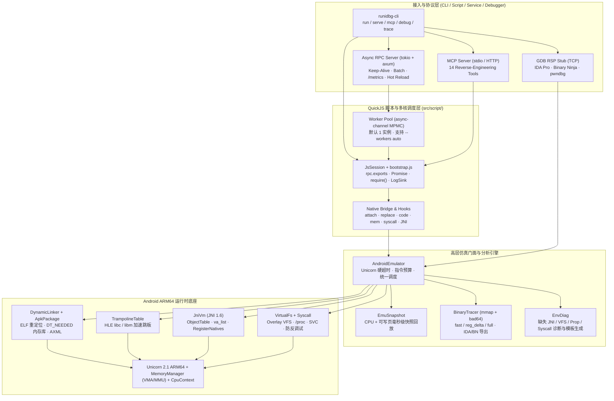

# runidbg (`runidbg-arm64-emu-tracer`)

纯 Rust 实现的高性能 Android ARM64 `.so` 仿真器、二进制指令级 Tracer 与 QuickJS 脚本引擎，内置异步高并发 RPC 服务与 MCP（Model Context Protocol）AI Agent 接入能力。

## 核心特性

- **Android ARM64 仿真底座**：基于 Unicorn 2.1 + `goblin`，支持完整 ELF 动态链接（`.init_array`、`IRELATIVE`、符号重定位、TLS `TPIDR_EL0`）、HLE libc/libm 加速、虚拟内存管理（MMU/VMA）、VFS 与系统属性模拟、SVC 系统调用与防反调试。
- **JNI 1.6 完整环境**：支持 `JNI_OnLoad`、`RegisterNatives`、内置常用 Java 类模型与可插拔 JNI Hook。
- **高速二进制 Tracer**：支持 `fast` / `reg_delta` / `full` 三级追踪、`mmap` 双流持久化（`.idx` + `.ext`）、离线检索及 IDA / Binary Ninja 脚本导出。
- **快照与并发回放**：支持 `EmuSnapshot` 毫秒级保存与恢复，适配高并发无状态算法/签名调用。
- **QuickJS 脚本引擎（V1 + V2）**：内置零配置 JS 运行时，提供 `Emu` / `Module` / `jni` / `mem` / `regs` / `hook`（`attach`、`replace`、`code`、`mem`、`syscall`）/ `vfs` / `trace` / `fs` / CommonJS `require()` 与完整 TypeScript 声明（`runidbg.d.ts`）。
- **异步高并发 RPC 服务**：基于 `tokio` + `axum` 与多 Worker 实例池（默认单实例 `workers = 1`，支持 `--workers auto` 无锁多核并行），支持 Keep-Alive、背压 `503`、Unicorn 硬超时/指令预算 `504`、JSON-RPC 2.0 Batch、`GET /metrics`、滚动热重载及 `async` 导出函数。
- **MCP AI 逆向闭环**：支持 stdio 与 Streamable HTTP（`--http`）双模式，提供 14 个逆向工具（含 `bad64` 反汇编、函数级 Trace、一次性 Hook 抓取与缺环境诊断）。
- **逆向与调试效率**：内置缺环境自动诊断器（`EnvDiag` 自动生成补环境 JS 模板）、APK 一键内存加载（`loadApk`）与 ARM64 GDB RSP Stub（直连 IDA Pro / Binary Ninja / pwndbg）。

## 项目架构



### 目录结构

```text
src/
├── lib.rs              # 库入口与核心导出
├── main.rs             # 最小命令行示例入口（直接加载 .so 并执行指定符号）
├── emulator.rs         # AndroidEmulator / AndroidEmulatorBuilder 门面
├── cpu.rs              # ARM64 寄存器与调用约定封装
├── crash.rs            # Guest 崩溃报告捕获（反汇编、寄存器、调用栈与面包屑）
├── logging.rs          # 结构化日志初始化（compact / json）
├── diag.rs             # 缺环境自动诊断器与 JS 补环境模板生成
├── debug/gdbstub.rs    # ARM64 GDB Remote Serial Protocol 远程调试服务端
├── memory.rs           # VMA 虚拟内存管理与访存辅助
├── snapshot.rs         # 内存 + 寄存器快照保存与恢复
├── error.rs            # 统一错误类型
├── loader/             # ELF 解析、动态链接器、APK 一键加载与 HLE Trampoline
├── os/                 # 设备画像（DeviceProfile）、SVC 系统调用、VFS 虚拟文件系统、协作调度
├── jni/                # JNI 1.6 Env、对象表、va_list 解析与 Hook 处理
├── tracer/             # 高速二进制追踪引擎、记录格式与离线 Reader
├── script/             # QuickJS 脚本引擎、RPC 与 MCP
│   ├── mod.rs          # JsSession / JsRunner / RUNIDBG_DTS 门面
│   ├── bridge.rs       # QuickJS ↔ Rust 原生桥接实现
│   ├── hooks.rs        # 原生函数/指令/内存/Syscall Hook 与 TB 缓存刷新
│   ├── jni_bridge.rs   # JS JNI Hook 桥接
│   ├── bootstrap.js    # JS 运行时封装与 rpc.exports / Promise 调度
│   ├── runidbg.d.ts    # TypeScript 类型声明
│   ├── rpc.rs          # 异步 HTTP + JSON-RPC 2.0 + 多 Worker 池 + Metrics + 热重载
│   └── mcp.rs          # MCP stdio / Streamable HTTP 服务端（14 个逆向工具）
└── bin/runidbg-cli.rs    # 统一命令行工具（run / serve / mcp / debug / trace 分析）
```

## Feature 开关

| Feature | 默认启用 | 说明 |
| --- | --- | --- |
| `js` | 是 | QuickJS 脚本引擎（`rquickjs`） |
| `rpc` | 是 | 异步高并发 HTTP / JSON-RPC 2.0 服务（`tokio`、`axum`、`async-channel`、`serde_json`） |
| `mcp` | 是 | MCP stdio / HTTP JSON-RPC 2.0 服务端（`serde_json`） |
| `apk` | 是 | APK 一键解析与内存加载（`zip`） |

纯核心库最小构建（不引入 JS/HTTP/ZIP 依赖，仍包含核心仿真、Tracer、EnvDiag 与 GDB Stub）：

```bash
cargo build --no-default-features
```

## 快速上手

### 1. 运行 QuickJS 仿真脚本（含 APK 加载与缺环境诊断）

```bash
# 导出 TypeScript 类型声明以获得 IDE 智能补全
cargo run --release --bin runidbg-cli -- init-types examples/scripts

# 运行示例脚本
cargo run --release --bin runidbg-cli -- run examples/scripts/cronet.js
```

### 2. 启动高并发 RPC 服务

```bash
# 默认单实例（workers = 1）
cargo run --release --bin runidbg-cli -- serve examples/scripts/rpc_demo.js \
  --listen 127.0.0.1:8080

# 生产多核模式（多 Worker + 硬指令预算 + 热重载）
cargo run --release --bin runidbg-cli -- serve examples/scripts/rpc_demo.js \
  --listen 0.0.0.0:8080 \
  --workers auto \
  --max-queue 2048 \
  --timeout-ms 15000 \
  --max-insns 5000000 \
  --allow-reload
```

常用接口：
- `GET /health`：查看服务状态、Worker 数、队列负载、热重载版本与导出方法
- `GET /metrics` / `GET /metrics?format=prom`：JSON 或 Prometheus 格式运行指标与延迟分桶
- `GET /exports`：列出 `rpc.exports` 全部导出方法
- `POST /call/<method>`：直接调用导出方法（Body 为 JSON 参数数组）
- `POST /rpc`：标准 JSON-RPC 2.0（支持单条与 Batch 数组并行调用）
- `POST /admin/reload`：先校验后原子滚动热重载（需 `--allow-reload`）
- `POST /eval`：动态执行 JS（需 `--allow-eval`）

### 3. 接入 MCP 客户端（stdio 或 Streamable HTTP）

```json
{
  "mcpServers": {
    "runidbg": {
      "command": "/path/to/target/release/runidbg-cli",
      "args": ["mcp", "--cwd", "/path/to/workspace"]
    }
  }
}
```

或启动 Streamable HTTP MCP 供远程 Agent 接入：
```bash
cargo run --release --bin runidbg-cli -- mcp --http 127.0.0.1:8090 --cwd .
```

### 4. GDB RSP 远程调试（直连 IDA Pro / Binary Ninja / pwndbg）

```bash
cargo run --release --bin runidbg-cli -- debug samples/libstatic-webp.so WebPGetDecoderVersion --listen 127.0.0.1:1234
# 在 gdb-multiarch / pwndbg 中连接：
# target remote 127.0.0.1:1234
```

## 性能实测对比（vs Java unidbg）

测试环境：Apple Silicon（10 核 ARM64 macOS）、JDK 21（`unidbg 0.9.9`）vs `runidbg-cli --release`，样本为同一份 2 MB stripped Android ARM64 安全签名 `.so`（含 `libc++_shared.so` 依赖）。以下三组均基于**两边 100% 产出相同有效签名结果**的同口径对齐实测：

### 1. 冷启动与进程内热态调用

| 指标 | Java `unidbg` | Rust `runidbg-cli` | 对比 |
| --- | ---: | ---: | --- |
| 环境初始化 + `.so` 加载 | 1,666 ms | **40 ms** | **41.7× 更快** |
| `JNI_OnLoad` | 72 ms | **37 ms** | **1.9× 更快** |
| **总冷启动耗时** | 1,738 ms | **77 ms** | **22.6× 更快** |
| 进程内单核热态调用（50 次均值） | 3.80 ms/次（263.4 QPS） | **1.30 ms/次（769.2 QPS）** | **2.92× 更快** |

### 2. HTTP RPC 并发服务（100% 返回值校验通过）

> Java 侧使用 JDK 21 内置 `HttpServer` 封装单实例 `unidbg`，Rust 侧直接使用 `runidbg-cli serve`。

| 服务配置 | 校验通过 | QPS | p50 延迟 | p95 延迟 | 常驻内存 (RSS) | 对比 |
| --- | :---: | ---: | ---: | ---: | ---: | --- |
| Java `unidbg`（1 worker） | 100/100 | 254.7 | 38.35 ms | 41.03 ms | 122.1 MB | 1×（基线） |
| Rust `runidbg`（`--workers 1`） | 100/100 | **628.7** | **15.83 ms** | **15.99 ms** | **21.7 MB** | **2.47× QPS / 省 82% 内存** |
| Rust `runidbg`（`--workers auto=10`） | 200/200 | **1,141.0** | **8.74 ms** | 35.94 ms | **127.5 MB** | **4.48× QPS（10 实例 ≈ Java 1 实例内存）** |

### 3. 全模块指令级 Trace（`[base, base+size]`）

| 引擎 / 模式 | 耗时 | 记录条数 | 归一化吞吐 | 单条落盘开销 | 吞吐倍率 |
| --- | ---: | ---: | ---: | ---: | --- |
| Java `unidbg`（`traceCode` 文本流） | 1,851.1 ms | 275,381 | 0.149 M insns/s | ~118 B/条（31 MB） | 1×（基线） |
| Rust `runidbg`（`fast` 二进制 mmap） | **64 ms** | 1,090,194 | **17.03 M insns/s** | 32 B/条（33 MB） | **114× 更快** |
| Rust `runidbg`（`reg_delta` 二进制 mmap） | **212 ms** | 1,090,194 | **5.14 M insns/s** | 32 B/条（33 MB） | **34.5× 更快** |
| Rust `runidbg`（`full` 双流 + 20.1 万内存事件） | **233 ms** | 1,090,194 + 201,209 ext | **4.68 M insns/s** | 32 B/条（33 MB + 6.1 MB） | **31.4× 更快** |

## 测试与校验

```bash
# 全量测试
cargo test

# 全 feature 组合 Clippy 零警告校验
cargo clippy --all-targets -- -D warnings
cargo clippy --no-default-features --all-targets -- -D warnings
cargo clippy --no-default-features --features js --all-targets -- -D warnings
cargo clippy --no-default-features --features mcp --all-targets -- -D warnings
```
