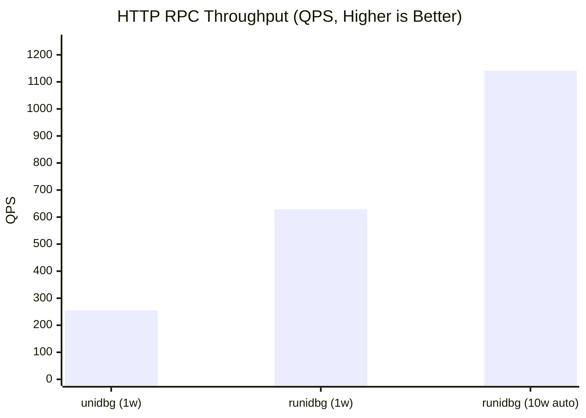
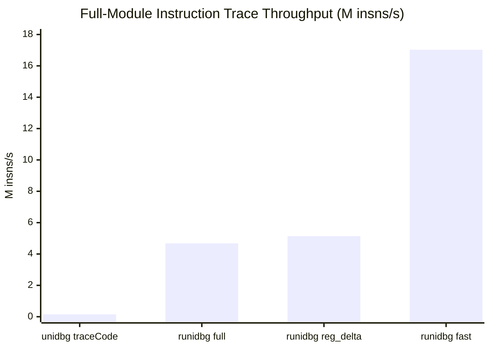
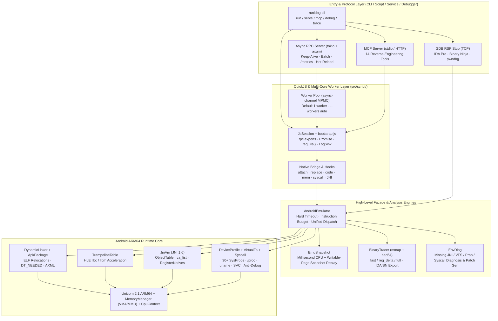

> [!WARNING]
> **Disclaimer**: This project (`runidbg`) is intended strictly for **binary security research, reverse-engineering education, benchmarking, and authorized security testing**. Any unlawful or unauthorized use is strictly prohibited; users assume full legal responsibility for how they use this software.

<div align="center">

# ⚡ runidbg (`runidbg-arm64-emu-tracer`)

**`Rust + unidbg = runidbg` · High-Performance Android ARM64 `.so` Emulator, Zero-Copy Binary Tracer & QuickJS Scripting Engine in Pure Rust**  
Built-in Async Multi-Core RPC Server · MCP AI Reverse-Engineering Loop · GDB RSP Debugger · Unified Device Profile

[简体中文](./README.md) | **English** | [Full Guide](./docs/GUIDE.md) | [AI Agent Skill](./docs/SKILL.md)


| 🚀 Cold Start | 🔥 Full-Module Trace | 💾 Single-Worker RPC RAM | ⚙️ Multi-Core RPC | 📦 Trace Footprint |
| :---: | :---: | :---: | :---: | :---: |
| **77 ms** (`22.6×` vs unidbg) | **17.03 M insns/s** (`114×` vs unidbg) | **21.7 MB** (`82%` less) | **1,141 QPS** (10 cores) | **32 B / insn** (`3.7×` smaller) |

</div>

---

## 🤝 Incompatible Sample Reports & Contributions Welcome

`runidbg` is actively evolving — **incompatible Android ARM64 `.so` samples, bug reports, and pull requests are warmly welcomed!** Every real-world sample helps us expand HLE libc, syscall, VFS, and JNI coverage.

When opening an Issue or PR, please redact any private credentials (cookies/tokens) and include:
1. A **minimal reproduction script** (QuickJS or Rust) with sanitized test inputs;
2. **`EnvDiag` output** (`JSON.stringify(emu.diag.report(), null, 2)` listing missing files, system properties, syscalls, and JNI methods);
3. **Guest crash report** (if applicable, `emu.lastCrash()?.formatted` with ARM64 disassembly, registers, backtrace, and breadcrumbs).

---

## ✨ Key Features

- **🦀 Pure-Rust Android ARM64 Runtime**: Built on Unicorn 2.1 + `goblin` with full ELF dynamic linking (`.init_array`, `IRELATIVE`, symbol relocations, recursive `DT_NEEDED`, TLS `TPIDR_EL0`), high-level libc/libm HLE acceleration (including real AAPCS64 `vsnprintf`/`__snprintf_chk`/`sscanf`/`asprintf`/`atoll`), VMA/MMU memory management, and anti-debugging evasion.
- **📱 Unified `DeviceProfile` & Dual-Mode Clock**: Ships with realistic Android presets (`pixel5` / `pixel8pro` / `s24ultra` / `xiaomi14`) plus per-field overrides that automatically synchronize **30+ Android system properties**, `/proc/cpuinfo`, `/proc/meminfo`, `/proc/version`, `/sys/devices/system/cpu/online`, and `uname`. Switch between deterministic virtual time and live host time (`realClock`) in one line.
- **🧬 Complete JNI 1.6 Environment**: Supports `JNI_OnLoad`, `RegisterNatives`, container-safe local/global reference lifecycles, built-in Java models (`String` constructors & methods, `Thread.currentThread()`, primitive boxing `valueOf`), and pluggable Rust/JS JNI hooks.
- **⚡ Zero-Copy Binary Tracer**: Three granularity levels (`fast` / `reg_delta` / `full`), dual-stream `mmap` persistence (`.idx` + `.ext`, truncated to exact written size on finalize), millisecond offline `dump` / `search`, and one-command IDA Pro / Binary Ninja coverage script export.
- **📜 Zero-Config QuickJS Engine + TypeScript IntelliSense**: Write reverse-engineering scripts in JS with `Emu` / `Module` / `jni` / `mem` / `regs` / Frida-style `hook` (`attach`, `replace`, `code`, `mem`, `syscall`) / `vfs` / `trace` / `fs` / CommonJS `require()`, and export full `runidbg.d.ts` definitions via `runidbg-cli init-types`.
- **🌐 Production Async Multi-Core RPC Server**: Powered by `tokio` + `axum` + lock-free MPMC worker pool (`--workers auto`), with HTTP Keep-Alive, backpressure `503`, Unicorn hard timeout & instruction budget `504`, JSON-RPC 2.0 Batch, Prometheus `/metrics`, atomic rolling hot reload, and `async` exports.
- **🤖 MCP AI Reverse-Engineering Loop & Debugger**: Native stdio and Streamable HTTP MCP server (14 tools including `bad64` disassembly, function-level tracing, one-shot hooks, and crash inspection), `EnvDiag` missing-environment auto-patcher, in-memory APK loader, and ARM64 GDB RSP stub (IDA Pro / Binary Ninja / pwndbg).

---

## 📊 Performance Benchmark (vs Java `unidbg`)

> [!NOTE]
> **Methodology**: Apple Silicon (10-core ARM64 macOS), JDK 21 (`unidbg 0.9.9`) vs `runidbg-cli --release`, running the exact same ~2 MB stripped Android ARM64 signing `.so` (+ `libc++_shared.so`). All three benchmarks below are strictly aligned on the exact same call path where **both engines produce 100% identical valid signing outputs**.

### 1. Cold Start & In-Process Warm Execution

| Metric | Java `unidbg` | Rust `runidbg-cli` | Speedup |
| --- | ---: | ---: | :---: |
| Init + ELF Loading | 1,666 ms | **40 ms** | **41.7×** |
| `JNI_OnLoad` | 72 ms | **37 ms** | **1.9×** |
| **Total Cold Start** | 1,738 ms | **77 ms** | **22.6×** |
| Warm Single-Core Call (50-call avg) | 3.80 ms (263.4 QPS) | **1.30 ms (769.2 QPS)** | **2.92×** |

### 2. HTTP RPC Service Throughput & Memory (100% Output Verified)

> Java side wraps a single `unidbg` instance with JDK 21 `HttpServer` (`synchronized`); Rust side uses `runidbg-cli serve` out of the box.

| Configuration | Verified | Throughput (QPS) | p50 Latency | p95 Latency | Resident RAM (RSS) | Comparison |
| --- | :---: | ---: | ---: | ---: | ---: | --- |
| Java `unidbg` (1 worker) | 100/100 | 254.7 | 38.35 ms | 41.03 ms | 122.1 MB | Baseline `1×` |
| Rust `runidbg` (`--workers 1`) | 100/100 | **628.7** | **15.83 ms** | **15.99 ms** | **21.7 MB** | **2.47× QPS · 82% less RAM** |
| Rust `runidbg` (`--workers auto=10`) | 200/200 | **1,141.0** | **8.74 ms** | 35.94 ms | **127.5 MB** | **4.48× QPS · 10 workers ≈ 1 JVM** |



### 3. Full-Module Instruction Trace (`[base, base+size]`)

| Engine / Mode | Wall Time | Records | Normalized Throughput | Disk Footprint | Speedup |
| --- | ---: | ---: | ---: | ---: | :---: |
| Java `unidbg` (`traceCode` text) | 1,851.1 ms | 275,381 | 0.149 M insns/s | ~118 B/insn (31 MB) | `1×` |
| Rust `runidbg` (`fast` mmap binary) | **64 ms** | 1,090,194 | **17.03 M insns/s** | 32 B/insn (33 MB) | **114×** |
| Rust `runidbg` (`reg_delta` mmap binary) | **212 ms** | 1,090,194 | **5.14 M insns/s** | 32 B/insn (33 MB) | **34.5×** |
| Rust `runidbg` (`full` + 201k mem R/W) | **233 ms** | 1,090,194 + 201,209 ext | **4.68 M insns/s** | 32 B/insn (33 MB + 6.1 MB) | **31.4×** |



---

## ⚖️ Honest Comparison with Java `unidbg`

| Dimension | `runidbg` (This Project) | Java `unidbg` |
| --- | --- | --- |
| **Performance & Footprint** | ✅ Pure Rust: **22.6×** faster cold start, **2.9×** faster warm calls, **5.6×** lower single-worker RPC RAM (21.7 MB vs 122.1 MB) | ⚠️ JVM + JNI/JNA overhead (~1.7s cold start, ~122 MB per instance) |
| **Instruction Tracing** | ✅ Zero-copy binary mmap + offline `bad64` decoding: **31×–114×** faster, 3.7× smaller, built-in `dump`/`search`/IDA/BN export | ⚠️ Online Capstone text formatting in hot path (~0.15 M insns/s, ~118 B/insn) |
| **Scripting Ergonomics** | ✅ **Zero-compile QuickJS** + `runidbg.d.ts` IntelliSense + Frida-style hooks + `EnvDiag` auto-patch generator | ⚠️ Requires JDK/Maven project setup and Java compilation per iteration |
| **Engineering & AI Integration** | ✅ Built-in async multi-core HTTP/JSON-RPC 2.0, Prometheus `/metrics`, hot reload, **14-tool MCP server**, GDB RSP, APK loader | ⚠️ Primarily a Java library; RPC pooling, metrics, and AI agent integration require custom wrappers |
| **Platform & Arch Support** | ⚠️ **Android ARM64 (`aarch64`) only** — no ARM32 or iOS support yet | ✅ **Supports Android ARM32 / ARM64 and iOS (Mach-O / ObjC)** |
| **Maturity & Sample Ecosystem** | ⚠️ **Newer project** — verified on Cronet, Conscrypt, MMKV, SQLite, WebP, Zstd, and real MSSDK, but long-tail Android framework stubs & edge syscalls are still growing | ✅ **Years of community battle-testing** with extensive public examples, tutorials, and edge-case stubs |
| **Java Bytecode Execution** | ⚠️ No built-in ART/Dalvik bytecode interpreter; Java callbacks rely on built-in models + JS hooks | ⚠️ Same — relies on `AbstractJni` stubs rather than executing DEX bytecode |

> [!TIP]
> **Which should you choose?**
> - **Choose `runidbg`** if you target **Android ARM64 `.so`**, care about startup/RPC/Trace performance, prefer rapid JS/TS iteration, or want out-of-the-box multi-core RPC & MCP AI agent integration.
> - **Choose `unidbg`** if you need **ARM32** or **iOS Mach-O** emulation, or rely heavily on existing community Java harnesses.

---

## 🏗️ Architecture



---

## 🧩 Feature Flags

| Feature | Default | Description |
| --- | :---: | --- |
| `js` | ✅ | QuickJS scripting engine (`rquickjs`) |
| `rpc` | ✅ | Async multi-core HTTP / JSON-RPC 2.0 server (`tokio`, `axum`, `async-channel`, `serde_json`) |
| `mcp` | ✅ | MCP stdio / HTTP JSON-RPC 2.0 server (`serde_json`) |
| `apk` | ✅ | In-memory APK parser & `.so` loader (`zip`) |

Minimal core-only build (no JS / HTTP / ZIP dependencies; still includes emulation, `DeviceProfile`, Tracer, `EnvDiag`, and GDB Stub):

```bash
cargo build --no-default-features
```

---

## 🚀 Quickstart

### 1. Run QuickJS Emulation Scripts

```bash
# Export TypeScript type definitions for IDE autocomplete
cargo run --release --bin runidbg-cli -- init-types examples/scripts

# Run built-in Cronet & sanitized TikTok MSSDK examples
cargo run --release --bin runidbg-cli -- run examples/scripts/cronet.js
cargo run --release --bin runidbg-cli -- run examples/scripts/tiktok_metasec.js
```

### 2. Start Multi-Core Async RPC Server

```bash
# Single-worker mode (~22 MB RSS)
cargo run --release --bin runidbg-cli -- serve examples/scripts/tiktok_metasec.js \
  --listen 127.0.0.1:8080

# Production multi-core mode (auto workers + instruction budget + rolling hot reload)
cargo run --release --bin runidbg-cli -- serve examples/scripts/tiktok_metasec.js \
  --listen 0.0.0.0:8080 \
  --workers auto \
  --max-queue 2048 \
  --timeout-ms 15000 \
  --max-insns 5000000 \
  --allow-reload
```

Endpoints: `GET /health`, `GET /metrics` (`?format=prom`), `GET /exports`, `POST /call/<method>`, `POST /rpc` (JSON-RPC 2.0 single & batch), `POST /admin/reload`, `POST /eval`.

### 3. Offline Binary Trace Analysis

```bash
# Disassemble instructions with register deltas & correlated memory R/W (auto-detects sibling .ext)
runidbg-cli dump trace_full.idx --skip 0 --limit 50

# Search by register value / memory address / PC
runidbg-cli search trace_full.idx --val 0x03000001

# Export IDA Pro / Binary Ninja coverage highlight scripts
runidbg-cli export-ida trace_full.idx --base 0x40000000 --out ida_cov.py
runidbg-cli export-bn  trace_full.idx --base 0x40000000 --out bn_cov.py
```

### 4. MCP AI Agent Integration & GDB RSP Debugging

```bash
# Streamable HTTP MCP server (or omit --http for stdio mode)
runidbg-cli mcp --http 127.0.0.1:8090 --cwd .

# ARM64 GDB RSP server (connect via IDA Pro / Binary Ninja / gdb-multiarch `target remote 127.0.0.1:1234`)
runidbg-cli debug samples/libstatic-webp.so WebPGetDecoderVersion --listen 127.0.0.1:1234
```

---

## 🧪 Testing & Verification

```bash
# Full test suite (39/39 passing: Cronet, Conscrypt, MMKV, SQLite, WebP, Zstd, TikTok MSSDK, JS, RPC, MCP, GDB, APK, DeviceProfile)
cargo test

# Zero-warning Clippy across all feature combinations
cargo clippy --all-targets -- -D warnings
cargo clippy --no-default-features --all-targets -- -D warnings
cargo clippy --no-default-features --features js --all-targets -- -D warnings
cargo clippy --no-default-features --features mcp --all-targets -- -D warnings
```
