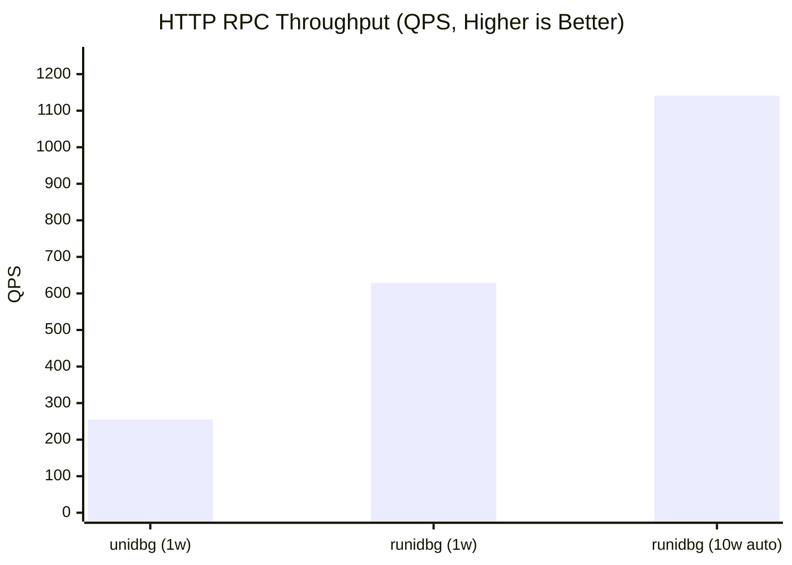
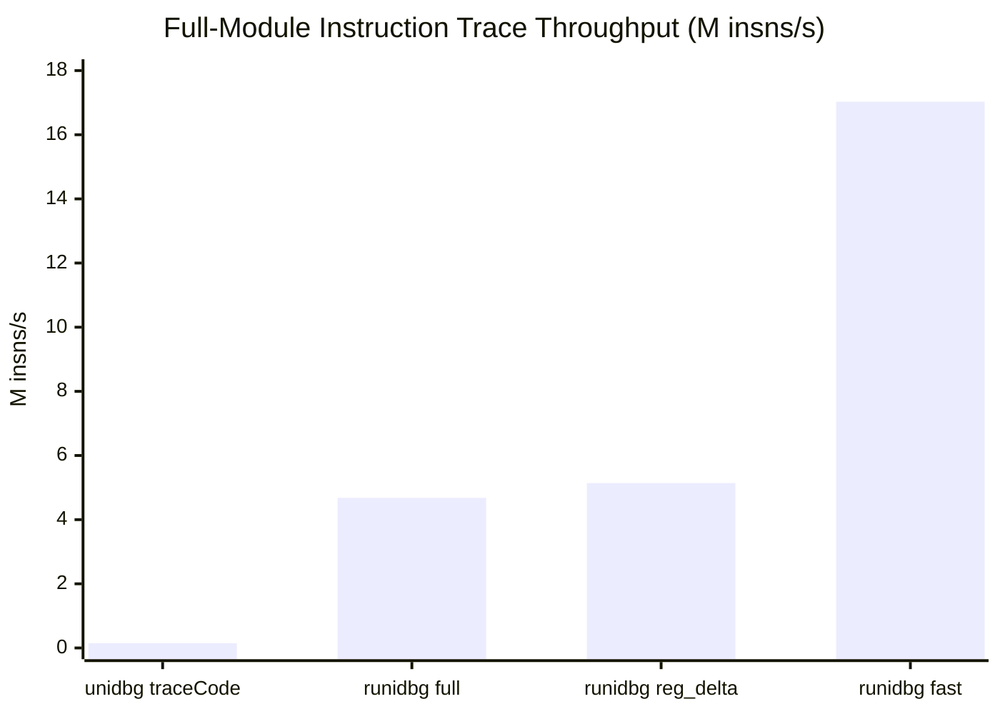
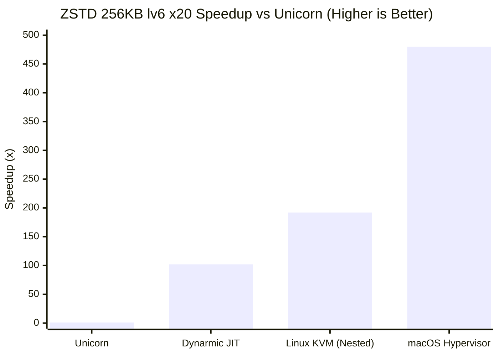
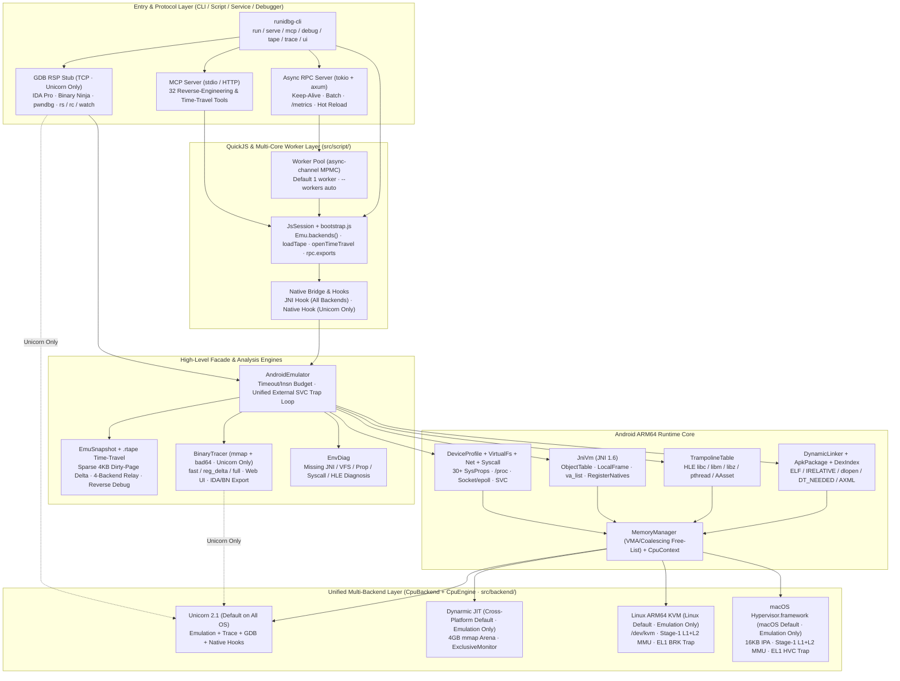

> [!WARNING]
> **Disclaimer**: This project (`runidbg`) is intended strictly for **binary security research, reverse-engineering education, benchmarking, and authorized security testing**. Any unlawful or unauthorized use is strictly prohibited; users assume full legal responsibility for how they use this software.

<div align="center">

# ⚡ runidbg (`runidbg-arm64-emu-tracer`)

**`Rust + unidbg = runidbg` · Multi-Backend High-Performance Android ARM64 `.so` Emulator, `.rtape` Time-Travel Debugger, Zero-Copy Binary Tracer & QuickJS Engine in Pure Rust**  
Unicorn / Dynarmic JIT / Linux KVM / macOS Hypervisor.framework · `.rtape` Cross-Backend Relay & Reverse Debugging · Async Multi-Core RPC · MCP AI Loop · GDB RSP

[简体中文](./README.md) | **English** | [Full Guide](./docs/GUIDE.md) | [AI Agent Skill](./docs/SKILL.md)


| 🚀 Cold Start | ⚡ HW / JIT Compute | 🔥 Full-Module Trace | 💾 Single-Worker RPC RAM | ⚙️ Multi-Core RPC |
| :---: | :---: | :---: | :---: | :---: |
| **77 ms** (`22.6×` vs unidbg) | **Up to 480×** (Hyper/KVM) / **102×** (Dynarmic) | **17.03 M insns/s** (`114×` vs unidbg) | **21.7 MB** (`82%` less) | **1,141 QPS** (10 cores) |

</div>

---

## 🤝 Incompatible Sample Reports & Contributions Welcome

`runidbg` is actively evolving — **incompatible Android ARM64 `.so` samples, bug reports, and pull requests are warmly welcomed!** Every real-world sample helps us expand HLE libc, syscall, VFS, and JNI coverage.

When opening an Issue or PR, please redact any private credentials (cookies/tokens) and include:
1. A **minimal reproduction script** (QuickJS or Rust) with sanitized test inputs;
2. **`EnvDiag` output** (`JSON.stringify(emu.diag.report(), null, 2)` listing missing files, system properties, syscalls, and JNI methods);
3. **Guest crash report** (if applicable, `emu.lastCrash()?.formatted` with ARM64 disassembly, registers, backtrace, and breadcrumbs).

---

## ✨ Key Features

- **⚡ Pluggable 4-Backend ARM64 Execution Engine (`CpuBackend` + `CpuEngine`)**:
  - **`unicorn` (default, full-featured)**: Powered by Unicorn 2.1 — **the only backend supporting instruction/memory Trace, GDB RSP debugging, and native code/mem/syscall hooks**;
  - **`dynarmic` (cross-platform JIT, emulation-only)**: Powered by `dynarmic 0.1.3` (zero system Boost dependency, 4GB contiguous Unix `mmap` arena preventing 128-bit NEON cross-page corruption, and `ExclusiveMonitor` for ARM64 atomics), delivering **7×–100×** compute speedups and **1.4×–5×** end-to-end speedups;
  - **`kvm` (Linux ARM64 hardware virtualization, emulation-only, compiled by default on Linux)**: Zero external crates talking directly to `/dev/kvm` ioctls with Stage-1 L1+L2 identity page tables, ARM64 `dc cvau + ic ivau` I-cache maintenance, and partial `mem_unmap`;
  - **`hypervisor` / `hyper` (macOS Apple Silicon hardware virtualization, emulation-only, compiled by default on macOS)**: Zero external crates calling `Hypervisor.framework` with 16KB host IPA + 4KB logical guest pages and Stage-1 L1+L2 page tables, up to **480×** faster than Unicorn and **4.7×** faster than Dynarmic on heavy compute.
- **🦀 Pure-Rust Android ARM64 Runtime**: Built on `goblin` with full ELF dynamic linking (`.init_array`, `R_AARCH64_IRELATIVE`, symbol relocations, recursive `DT_NEEDED`, `dlopen`/`dlsym`/`dladdr`/`dl_iterate_phdr`, TLS `TPIDR_EL0`), libc/libm/libz/AAssetManager/pthread/`setjmp`/`longjmp`/directory HLE acceleration, a coalescing Free-List guest heap allocator, full snapshot/restore (CPU + writable RAM + heap metadata + JNI tables), and anti-debugging evasion.
- **📱 Unified `DeviceProfile` & Dual-Mode Clock**: Ships with realistic Android presets (`pixel5` / `pixel8pro` / `s24ultra` / `xiaomi14`) plus per-field overrides that automatically synchronize **30+ Android system properties**, `/proc/cpuinfo`, `/proc/meminfo`, `/proc/version`, `/sys/devices/system/cpu/online`, and `uname`. Switch between deterministic virtual time and live host time (`realClock`) in one line.
- **🧬 Complete JNI 1.6 Environment**: Supports `JNI_OnLoad`, `RegisterNatives`, container-safe local/global reference lifecycles with `PushLocalFrame`/`PopLocalFrame` (plus `emu.jni.withLocalFrame` in JS for leak-free long-lived RPC workers), built-in Java models (`String` constructors & methods, `Thread.currentThread()`, primitive boxing `valueOf`), and pluggable Rust/JS JNI hooks.
- **🌍 Host Socket Passthrough, Event Loop & Virtual NIC (`emu.net`)**: Zero-dependency real TCP/UDP passthrough, `epoll`/`ppoll`/`eventfd2`/`pipe2` async multiplexing primitives, `getaddrinfo`/`getifaddrs`/`ioctl(SIOCGIF*)`, `/proc/net/*` virtual NIC profile, and QuickJS packet capture + `onSend`/`onRecv` live interception — **offline-safe by default (`-EACCES`) with explicit opt-in & `allowHosts` allowlist**.
- **⚡ Zero-Copy Binary Tracer & Offline Analysis**: Three granularity levels (`fast` / `reg_delta` / `full`), dual-stream `mmap` persistence (`.idx` + `.ext`, truncated on finalize), post-exec register attribution with inline ASCII hints, millisecond offline `dump` / `search --val --ascii --bytes` / `stats` / `calltree` / `crypto-scan`, and one-command IDA Pro / Binary Ninja coverage script export.
- **📜 Zero-Config QuickJS Engine + TypeScript IntelliSense**: Write reverse-engineering scripts in JS with `Emu` / `Module` / `jni` / `mem` / `regs` / Frida-style `hook` (`attach`, `replace`, `code`, `mem`, `syscall`) / `vfs` / `net` / `trace` / `fs` / CommonJS `require()`, and export full `runidbg.d.ts` definitions via `runidbg-cli init-types`.
- **🌐 Production Async Multi-Core RPC Server**: Powered by `tokio` + `axum` + lock-free MPMC worker pool (`--workers auto`), with HTTP Keep-Alive, backpressure `503`, Unicorn hard timeout & instruction budget `504`, JSON-RPC 2.0 Batch, Prometheus `/metrics`, atomic rolling hot reload, and `async` exports.
- **📼 Persistent `.rtape` Snapshots & Deterministic Time-Travel Debugging (Phase 1 + Phase 2)**:
  - **Multi-Checkpoint Sparse 4KB Dirty-Page Delta + 4-Backend Relay**: Persists full CPU registers, VMAs / heap / non-zero 4KB pages, linker + APK memory libs, HLE handles, JNI + `DexIndex`, and VFS / Socket state into a compact single-file `.rtape` (`BASE` skips zero pages; `DELTA` stores only 4KB dirty-page diffs). Fast-forward initialization on **`Dynarmic` / `Hypervisor` / `KVM`**, save a tape, and relay seamlessly into **`Unicorn`** for Tracing, GDB, or Time-Travel recording.
  - **Deterministic Time-Travel & Reverse Taint Tracking**: `EventLogBus` captures live clock reads (`realClock`), external `JniHandler` `ObjectTableDelta` mutations, and read-only host `sysroot` files for **100% bit-exact offline JS-free replay** (verified on real TikTok `libmetasec_ov.so`: 4.16M instructions in 5.5 MB, 43/43 keyframes bit-exact). Powered by an LRU keyframe cache + micro-snapshot ring for millisecond `seek`, sub-millisecond reverse single-step (`rs` / `bs`), GDB reverse continue (`rc` / `bc`), reverse write/read/access watchpoints (`Z2` / `Z3` / `Z4`), Live Fork exploration, and an embedded dark-mode Web UI timeline cockpit (`runidbg-cli ui <file.rtape>`).
- **🤖 MCP AI Reverse-Engineering Loop & Debugger**: Native stdio and Streamable HTTP MCP server (**32 tools** covering `bad64` disassembly, `trace_calltree`, `trace_crypto_scan`, `trace_inspect`, `emu_load_dex`, `emu_save_tape` / `emu_load_tape` / `emu_seek_tape`, and the `tt_record_start` / `tt_record_stop` / `tt_open` / `tt_seek` / `tt_reverse_watch` / `tt_mem_read` / `tt_close` time-travel workflow), `EnvDiag` missing-environment auto-patcher, lightweight DEX metadata index, full `stdio` HLE, embedded dark-mode Web UI (Trace + Time-Travel Cockpit + RPC + EnvDiag), in-memory APK loader, and time-travel-capable ARM64 GDB RSP stub.

---

## 📊 Performance Benchmark (vs Java `unidbg`)

> [!NOTE]
> **Methodology**: Apple Silicon (10-core ARM64 macOS), JDK 21 (`unidbg 0.9.9`) vs `runidbg-cli --release`, running the exact same ~2 MB stripped Android ARM64 signing `.so` (+ `libc++_shared.so`). All three benchmarks below are strictly aligned on the exact same call path where **both engines produce 100% identical valid signing outputs**.

### 1. Cold Start & In-Process Warm Execution

| Metric | Java `unidbg` | Rust `runidbg-cli` | Speedup |
| --- | ---: | ---: | :---: |
| Init + ELF Loading | 1,666 ms | **40 ms** | **41.7×** |
| `JNI_OnLoad` | 72 ms | **37 ms** | **1.9×** |
| **Total Cold Start** | 1,738 ms | **77 ms** | **22.6×** |
| Warm Single-Core Call (50-call avg) | 3.80 ms (263.4 QPS) | **1.30 ms (769.2 QPS)** | **2.92×** |

### 2. HTTP RPC Service Throughput & Memory (100% Output Verified)

> Java side wraps a single `unidbg` instance with JDK 21 `HttpServer` (`synchronized`); Rust side uses `runidbg-cli serve` out of the box.

| Configuration | Verified | Throughput (QPS) | p50 Latency | p95 Latency | Resident RAM (RSS) | Comparison |
| --- | :---: | ---: | ---: | ---: | ---: | --- |
| Java `unidbg` (1 worker) | 100/100 | 254.7 | 38.35 ms | 41.03 ms | 122.1 MB | Baseline `1×` |
| Rust `runidbg` (`--workers 1`) | 100/100 | **628.7** | **15.83 ms** | **15.99 ms** | **21.7 MB** | **2.47× QPS · 82% less RAM** |
| Rust `runidbg` (`--workers auto=10`) | 200/200 | **1,141.0** | **8.74 ms** | 35.94 ms | **127.5 MB** | **4.48× QPS · 10 workers ≈ 1 JVM** |



### 3. Full-Module Instruction Trace (`[base, base+size]`)

| Engine / Mode | Wall Time | Records | Normalized Throughput | Disk Footprint | Speedup |
| --- | ---: | ---: | ---: | ---: | :---: |
| Java `unidbg` (`traceCode` text) | 1,851.1 ms | 275,381 | 0.149 M insns/s | ~118 B/insn (31 MB) | `1×` |
| Rust `runidbg` (`fast` mmap binary) | **64 ms** | 1,090,194 | **17.03 M insns/s** | 32 B/insn (33 MB) | **114×** |
| Rust `runidbg` (`reg_delta` mmap binary) | **212 ms** | 1,090,194 | **5.14 M insns/s** | 32 B/insn (33 MB) | **34.5×** |
| Rust `runidbg` (`full` + 201k mem R/W) | **233 ms** | 1,090,194 + 201,209 ext | **4.68 M insns/s** | 32 B/insn (33 MB + 6.1 MB) | **31.4×** |



### 4. Multi-Backend Benchmark (`Unicorn` vs `Dynarmic` vs `Hypervisor` / `KVM`)

> [!NOTE]
> Measured with the same `runidbg-cli` (dev build) on **Apple Silicon M4** (Unicorn / Dynarmic / Hypervisor.framework) and **Ubuntu 26.04 Linux 7.0 `aarch64`** (nested virtualization `/dev/kvm` on M4), verifying 100% bit-exact outputs across all backends:

| Workload | Unicorn | Dynarmic (JIT) | Hypervisor (macOS M4) | KVM (Linux ARM64 Nested) | Peak Speedup |
| --- | ---: | ---: | ---: | ---: | :---: |
| **ZSTD 256KB lv6 × 20** (heavy compute / NEON) | 24,964 ms | 245 ms (`102×`) | **52 ms (`480×`)** | 105 ms (`192×`) | **480×** |
| **ZSTD 26.4KB lv3 × 100** (light compute / high call rate) | 493 ms | **10 ms (`49×`)** | 14 ms (`35×`) | 113 ms (`8.3×`) | **49×** |
| **TikTok `libmetasec_ov.so` 10× Sign** (heavy HLE / JNI) | 398 ms | 76 ms (`5.2×`) | **37 ms (`10.8×`)** | 623 ms (bare-metal ~30–40ms) | **10.8×** |



> [!TIP]
> **Choosing a Backend**:
> - **Reverse Engineering / Tracing / GDB / Native Code & Mem Hooks** → Use **`unicorn`** (other backends are emulation-only and explicitly reject Trace / GDB / native hooks).
> - **High-Throughput Compute / Batch Signing / Production RPC** → Use **`dynarmic`** (no signing requirement, unlimited concurrent workers per process) or hardware virtualization via **`hypervisor`** (macOS Apple Silicon, requires `com.apple.security.hypervisor` entitlement, 1 VM/process) or **`kvm`** (Linux ARM64 `/dev/kvm`, multi-VM per process).

---

## ⚖️ Honest Comparison with Java `unidbg`

| Dimension | `runidbg` (This Project) | Java `unidbg` |
| --- | --- | --- |
| **Performance & Footprint** | ✅ Pure Rust + **4 execution backends (Unicorn / Dynarmic / KVM / Hypervisor)**: **22.6×** faster cold start, up to **480×** HW compute speedup, **5.6×** lower single-worker RPC RAM (21.7 MB vs 122.1 MB) | ⚠️ JVM + JNI/JNA overhead (~1.7s cold start, ~122 MB per instance) |
| **Instruction Tracing** | ✅ Zero-copy binary mmap + offline `bad64` decoding: **31×–114×** faster, 3.7× smaller, built-in `dump`/`search`/IDA/BN export | ⚠️ Online Capstone text formatting in hot path (~0.15 M insns/s, ~118 B/insn) |
| **Scripting Ergonomics** | ✅ **Zero-compile QuickJS** + `runidbg.d.ts` IntelliSense + Frida-style hooks + `EnvDiag` auto-patch generator | ⚠️ Requires JDK/Maven project setup and Java compilation per iteration |
| **Engineering & AI Integration** | ✅ Built-in async multi-core HTTP/JSON-RPC 2.0, Prometheus `/metrics`, hot reload, **32-tool MCP server**, **`.rtape` snapshots & time-travel reverse debugging**, Host Socket passthrough & packet capture, GDB RSP, APK loader | ⚠️ Primarily a Java library; RPC pooling, metrics, time-travel, and AI agent integration require custom wrappers |
| **Platform & Arch Support** | ⚠️ **Android ARM64 (`aarch64`) only** — no ARM32 or iOS support yet | ✅ **Supports Android ARM32 / ARM64 and iOS (Mach-O / ObjC)** |
| **Maturity & Sample Ecosystem** | ⚠️ **Newer project** — verified on Cronet, Conscrypt, MMKV, SQLite, WebP, Zstd, and real MSSDK, but long-tail Android framework stubs & edge syscalls are still growing | ✅ **Years of community battle-testing** with extensive public examples, tutorials, and edge-case stubs |
| **Java Bytecode Execution** | ⚠️ No built-in ART/Dalvik bytecode interpreter; Java callbacks rely on built-in models + JS hooks | ⚠️ Same — relies on `AbstractJni` stubs rather than executing DEX bytecode |

> [!TIP]
> **Which should you choose?**
> - **Choose `runidbg`** if you target **Android ARM64 `.so`**, care about startup/RPC/Trace performance, prefer rapid JS/TS iteration, or want out-of-the-box multi-core RPC & MCP AI agent integration.
> - **Choose `unidbg`** if you need **ARM32** or **iOS Mach-O** emulation, or rely heavily on existing community Java harnesses.

---

## 🏗️ Architecture



---

## 🧩 Feature Flags & Platform Defaults

| Feature | Default | Description |
| --- | :---: | --- |
| `js` | ✅ | QuickJS scripting engine (`rquickjs`) |
| `rpc` | ✅ | Async multi-core HTTP / JSON-RPC 2.0 server (`tokio`, `axum`, `async-channel`, `serde_json`) |
| `mcp` | ✅ | MCP stdio / HTTP JSON-RPC 2.0 server (`serde_json`) |
| `apk` | ✅ | In-memory APK parser & `.so` loader (`zip`) |
| `ui` | ✅ | Embedded offline Trace dark-mode Web UI (`runidbg-cli ui`) |
| `dynarmic` | ✅ | Cross-platform Dynarmic ARM64 JIT backend (**emulation-only**, requires `cmake` + `ninja`) |
| `kvm` | ✅ (Linux) | Linux ARM64 `/dev/kvm` hardware virtualization backend (**emulation-only**, compiled on Linux only) |
| `hypervisor` | ✅ (macOS) | macOS Apple Silicon `Hypervisor.framework` backend (**emulation-only**, compiled on macOS only) |

- **Linux default build**: `unicorn, dynarmic, kvm` (install `cmake ninja-build clang libclang-dev`)
- **macOS default build**: `unicorn, dynarmic, hypervisor` (for local builds, sign with `codesign --force --sign - --entitlements entitlements/hypervisor.plist target/release/runidbg-cli`; GitHub Release binaries are pre-signed)
- **Minimal Unicorn-only core build** (no JS / HTTP / ZIP / Dynarmic dependencies; still includes emulation, `DeviceProfile`, Tracer, `EnvDiag`, and GDB Stub):

```bash
cargo build --no-default-features
```

---

## 🚀 Quickstart

### 1. Run QuickJS Emulation Scripts

```bash
# Export TypeScript type definitions for IDE autocomplete
cargo run --release --bin runidbg-cli -- init-types examples/scripts

# Run built-in Cronet & sanitized TikTok MSSDK examples
cargo run --release --bin runidbg-cli -- run examples/scripts/cronet.js
cargo run --release --bin runidbg-cli -- run examples/scripts/tiktok_metasec.js
```

### 2. Start Multi-Core Async RPC Server

```bash
# Single-worker mode (~22 MB RSS)
cargo run --release --bin runidbg-cli -- serve examples/scripts/tiktok_metasec.js \
  --listen 127.0.0.1:8080

# Production multi-core mode (auto workers + instruction budget + rolling hot reload)
cargo run --release --bin runidbg-cli -- serve examples/scripts/tiktok_metasec.js \
  --listen 0.0.0.0:8080 \
  --workers auto \
  --max-queue 2048 \
  --timeout-ms 15000 \
  --max-insns 5000000 \
  --allow-reload
```

Endpoints: `GET /health`, `GET /metrics` (`?format=prom`), `GET /exports`, `POST /call/<method>`, `POST /rpc` (JSON-RPC 2.0 single & batch), `POST /admin/reload`, `POST /eval`.

### 3. Offline Binary Trace Analysis

```bash
# Disassemble instructions with register deltas & correlated memory R/W (auto-detects sibling .ext)
runidbg-cli dump trace_full.idx --skip 0 --limit 50

# Search by register value / memory address / PC
runidbg-cli search trace_full.idx --val 0x03000001

# Export IDA Pro / Binary Ninja coverage highlight scripts
runidbg-cli export-ida trace_full.idx --base 0x40000000 --out ida_cov.py
runidbg-cli export-bn  trace_full.idx --base 0x40000000 --out bn_cov.py
```

### 4. `.rtape` Relay, Time-Travel GDB Reverse Debugging & Web UI Cockpit

```bash
# Inspect .rtape checkpoints, timeline events, and compression stats
runidbg-cli tape info ./sign_tt.rtape

# Start Time-Travel GDB RSP server (auto-detects EVENT_LOG; supports rs / rc / watch / monitor seek / monitor rw)
runidbg-cli debug --tape ./sign_tt.rtape --listen 127.0.0.1:1234

# Launch embedded dark-mode Web UI Time-Travel Cockpit (interactive timeline scrubber, reverse watchpoints, reg diff, hex dump)
runidbg-cli ui ./sign_tt.rtape --listen 127.0.0.1:8088 --open

# Streamable HTTP MCP server (32 tools including tt_* time-travel suite; omit --http for stdio)
runidbg-cli mcp --http 127.0.0.1:8090 --cwd .

# Direct ARM64 GDB RSP debugging on a .so (IDA Pro / Binary Ninja / gdb-multiarch `target remote 127.0.0.1:1234`)
runidbg-cli debug samples/libstatic-webp.so WebPGetDecoderVersion --listen 127.0.0.1:1234
```

---

## 🧪 Testing & Verification

```bash
# Full test suite (91/91 passing: 4-backend parity, .rtape & time-travel, Web UI, Cronet, Conscrypt, MMKV, SQLite, WebP, Zstd, TikTok MSSDK, JS, RPC, MCP, GDB, APK, DeviceProfile)
cargo test --features ui

# Zero-warning Clippy across all feature combinations
cargo clippy --all-targets -- -D warnings
cargo clippy --no-default-features --all-targets -- -D warnings
cargo clippy --no-default-features --features js --all-targets -- -D warnings
cargo clippy --no-default-features --features mcp --all-targets -- -D warnings
cargo clippy --features dynarmic --all-targets -- -D warnings
cargo clippy --features hypervisor --all-targets -- -D warnings
cargo clippy --features ui --all-targets -- -D warnings
```

---

## 🙏 Acknowledgements

- Special thanks to [**unidbg**](https://github.com/zhkl0228/unidbg) and its author **`zhkl0228`**: the name `runidbg` (`Rust + unidbg`), Android sandbox architecture, and JNI bridging model are deeply inspired by `unidbg`. Building and continuously maintaining such a comprehensive Android ARM32/ARM64 and iOS emulator entirely by hand in the pre-AI era reflects extraordinary low-level engineering mastery and remarkable perseverance.
- Thanks as well to [Unicorn Engine](https://github.com/unicorn-engine/unicorn), [Dynarmic](https://github.com/merryhime/dynarmic), [QuickJS](https://bellard.org/quickjs/) / `rquickjs`, `goblin`, and `bad64`.
